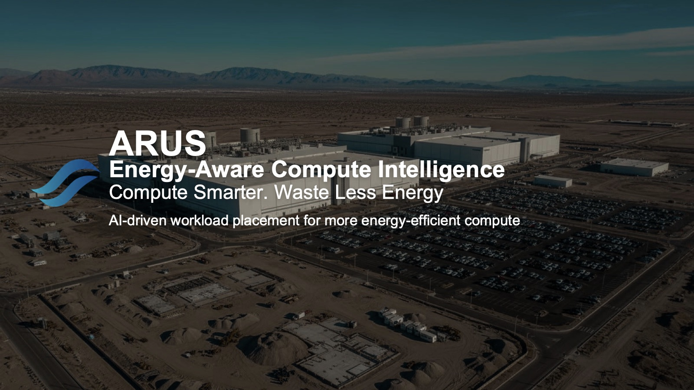
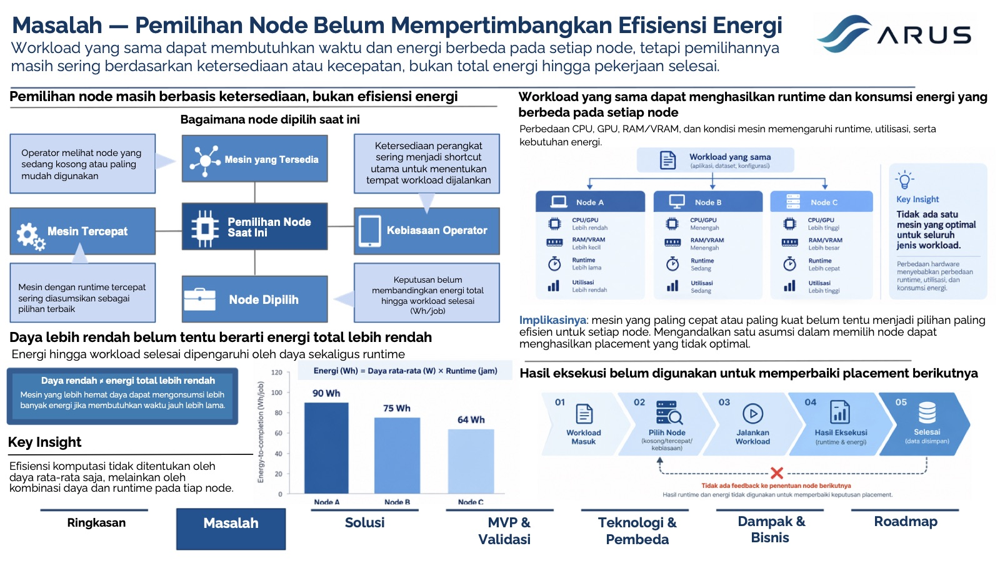
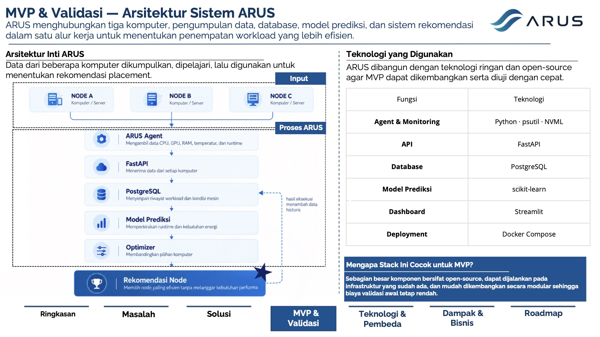
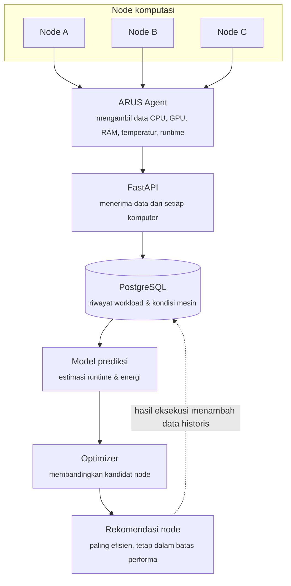
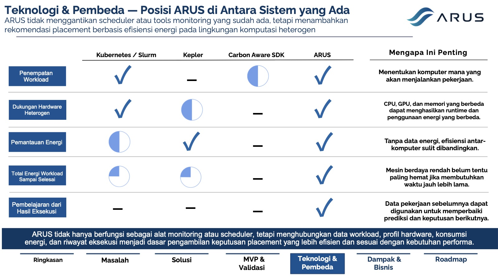
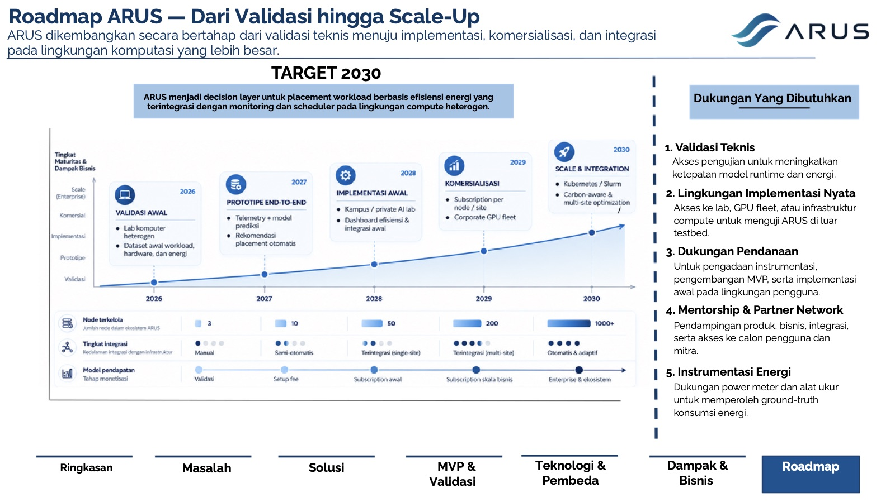

<div align="center">



# ARUS

**Energy-Aware Compute Intelligence: penempatan workload berbasis AI untuk komputasi yang lebih hemat energi.**

*Compute smarter. Waste less energy.*


**[📄 Pitch Deck (PDF)](docs/ARUS-Pitch-Deck.pdf)**

🇬🇧 [English](README.md) · 🇮🇩 Bahasa Indonesia

</div>

---

## Gambaran Umum

ARUS mengubah penempatan workload dari **keputusan berbasis ketersediaan** menjadi **keputusan berbasis efisiensi energi**.

Di banyak lab dan fleet komputasi, sebuah pekerjaan dijalankan di mesin yang sedang kosong, mesin tercepat, atau mesin yang biasa dipakai operator. Total energi yang dibutuhkan hingga pekerjaan *selesai* jarang dipertimbangkan. ARUS mempelajari perilaku workload pada setiap hardware, memprediksi runtime dan konsumsi energi di setiap kandidat node, lalu merekomendasikan node feasible dengan **prediksi energi per job (Wh/job) terendah** tanpa melanggar batas performa.

> **Status proyek:** ARUS berada pada tahap konsep dan desain MVP. Repositori ini berisi pitch deck dan rancangan teknis. Rencana validasi di bawah menjelaskan bagaimana MVP akan diuji; hasilnya akan ditambahkan setelah eksperimen dijalankan.

## Masalah



- **Penempatan masih mengandalkan jalan pintas.** Node dipilih karena kosong, paling cepat, atau kebiasaan, bukan karena paling efisien.
- **Daya rendah ≠ energi total lebih rendah.** Energi hingga selesai adalah *daya × runtime*. Mesin berdaya rendah bisa menghabiskan energi lebih besar jika waktunya jauh lebih lama.
- **Fleet komputasi semakin heterogen.** Perbedaan CPU, GPU, RAM/VRAM, dan generasi hardware membuat workload yang sama punya profil runtime dan energi yang berbeda.
- **Karakter workload beragam.** AI training, inference, data processing, dan CPU batch membebani hardware dengan cara berbeda, sehingga tidak ada satu node yang optimal untuk semuanya.
- **Hasil eksekusi terbuang.** Data run sebelumnya jarang dipakai untuk memperbaiki keputusan placement berikutnya.
- **Kebutuhan listrik meningkat cepat.** Menurut IEA, konsumsi listrik data center global diproyeksikan hampir dua kali lipat, dari sekitar 485 TWh pada 2025 menjadi sekitar 950 TWh pada 2030, terutama didorong oleh AI. Setiap peningkatan efisiensi placement berarti biaya dan emisi yang lebih rendah.

## Solusi

ARUS adalah **energy-aware decision engine** yang bekerja sebelum workload dijalankan:

1. **Memahami workload.** Membaca jenis workload, parameter eksekusi, dan kebutuhan resource.
2. **Mengenali setiap node.** Mengetahui konfigurasi CPU, GPU, RAM/VRAM, dan kemampuan hardware tiap node.
3. **Membaca kondisi node saat ini.** Mempertimbangkan availability dan kondisi resource, sehingga keputusan tidak hanya bergantung pada spesifikasi di atas kertas.
4. **Menyaring node yang mampu.** Hanya menyisakan node dengan CPU, GPU, RAM, dan kapasitas yang cukup.
5. **Memprediksi runtime dan energi.** Memperkirakan waktu penyelesaian dan konsumsi energi di tiap kandidat.
6. **Merekomendasikan node paling efisien.** Memilih node feasible dengan prediksi energi terendah sambil tetap menjaga performa.
7. **Belajar dari setiap eksekusi.** Runtime dan energi aktual dicatat dan dipakai untuk mengkalibrasi model secara bertahap.

## Arsitektur





### Tech Stack

| Fungsi | Teknologi |
|---|---|
| Agent & monitoring | Python · psutil · NVML |
| API | FastAPI |
| Database | PostgreSQL |
| Model prediksi | scikit-learn |
| Dashboard | Streamlit |
| Deployment | Docker Compose |

Stack ini ringan, open-source, dan modular. Semuanya dapat dijalankan di infrastruktur yang sudah ada, sehingga biaya validasi awal tetap rendah.

## Rencana Validasi MVP

**Setup pengujian**

- Workload yang sama dijalankan pada **tiga node dengan spesifikasi hardware berbeda**.
- Setiap run mencatat waktu penyelesaian, utilisasi CPU/GPU/RAM, temperatur, dan estimasi energi.
- Pengujian diulang agar hasil antar-node dapat dibandingkan secara konsisten.
- Jika tersedia, **power meter eksternal** dipakai sebagai ground-truth konsumsi energi.

**Metrik**

| Metrik | Pertanyaan yang dijawab |
|---|---|
| Akurasi prediksi runtime | Seberapa dekat prediksi waktu dengan waktu aktual? |
| Akurasi prediksi energi | Seberapa dekat prediksi energi dengan hasil pengukuran? |
| Akurasi rekomendasi | Apakah node yang direkomendasikan benar-benar lebih efisien? |
| Performa tetap terjaga | Apakah penghematan energi tercapai tanpa melanggar target performa? |

**Kriteria keberhasilan:** ARUS memberikan rekomendasi yang lebih hemat energi dibanding baseline sederhana (*node pertama yang kosong* dan *node tercepat*) dengan tetap memenuhi kebutuhan performa.

## Posisi ARUS di Antara Sistem yang Ada



ARUS **tidak** menggantikan scheduler atau tools monitoring yang sudah ada, melainkan menambahkan lapisan rekomendasi berbasis efisiensi energi di atasnya.

| Kemampuan | Kubernetes / Slurm | Kepler | Carbon Aware SDK | **ARUS** |
|---|:---:|:---:|:---:|:---:|
| Penempatan workload | ✅ | — | ◐ | ✅ |
| Dukungan hardware heterogen | ✅ | ◐ | — | ✅ |
| Pemantauan energi | ◐ | ✅ | — | ✅ |
| Total energi workload sampai selesai | ◔ | ◔ | — | ✅ |
| Pembelajaran dari hasil eksekusi | — | — | — | ✅ |

<sub>✅ didukung · ◐ sebagian · ◔ terbatas · — tidak didukung</sub>

### Semakin dipakai, semakin akurat

- **Data operasional.** Setiap run menambah data runtime dan energi aktual dari kombinasi workload × hardware yang baru.
- **Pembelajaran berkelanjutan.** Selisih prediksi dan hasil aktual dipakai untuk memperbaiki model secara bertahap.
- **Kalibrasi spesifik lingkungan.** Setiap kampus, lab, atau organisasi punya kombinasi hardware sendiri, dan ARUS dikalibrasi dengan data lokal.
- **Integrasi workflow.** Terhubung dengan monitoring node, database, power meter, dan scheduler yang sudah digunakan.

## Jalur Pasar

| Tahap | Segmen | Fokus |
|---|---|---|
| 1 · Validasi | Campus AI / research lab | Membangun dataset awal, uji di berbagai spesifikasi komputer, kalibrasi prediksi runtime dan energi |
| 2 · Early customer | Private AI / GPU lab | Validasi pada workload AI nyata, perbandingan node CPU vs GPU, efisiensi per job |
| 3 · Komersial | Corporate GPU fleet | Placement untuk workload berulang dalam skala besar, penghematan energi dan biaya |
| 4 · Scale | Medium compute infrastructure | Optimasi multi-node yang terintegrasi dengan monitoring dan scheduler yang ada |

**Model bisnis.** ARUS bersifat software-first. Pendapatan tumbuh seiring adopsi: **campus pilot** gratis/bersubsidi → **corporate pilot** berbayar (biaya setup & integrasi) → **production** (subscription per node per bulan atau lisensi tahunan) → **enterprise** (kontrak custom, integrasi lanjutan, atau skema berbasis penghematan).

**Struktur biaya MVP.** Tiga komputer uji dan backend memakai perangkat yang sudah ada, software stack open-source, dan pengembangan dilakukan langsung oleh founder. Investasi berikutnya adalah power meter untuk meningkatkan kualitas validasi.

## Roadmap



| Tahun | Milestone | Fokus | Node terkelola |
|---|---|---|---|
| 2026 | Validasi awal | Lab komputer heterogen, dataset awal workload, hardware, dan energi | 3 |
| 2027 | Prototipe end-to-end | Telemetry + model prediksi, rekomendasi placement otomatis | 10 |
| 2028 | Implementasi awal | Kampus / private AI lab, dashboard efisiensi, integrasi awal | 50 |
| 2029 | Komersialisasi | Subscription per node/site, corporate GPU fleet | 200 |
| 2030 | Scale & integrasi | Integrasi Kubernetes / Slurm, optimasi carbon-aware & multi-site | 1.000+ |

**Target 2030:** ARUS menjadi decision layer untuk penempatan workload berbasis efisiensi energi yang terintegrasi dengan monitoring dan scheduler di lingkungan compute heterogen.

## Struktur Repositori

```
ARUS/
├── README.md               # Dokumentasi bahasa Inggris
├── README.id.md            # Dokumentasi bahasa Indonesia
└── docs/
    ├── ARUS-Pitch-Deck.pdf # Pitch deck lengkap (12 slide)
    └── images/             # Cuplikan slide untuk README
```

## Pembuat

**Naufal Zaki**, konsep, riset, dan pitch deck.

---

<sub>© 2026 Naufal Zaki. Hak cipta dilindungi. Konsep, nama, dan materi pitch ARUS tidak boleh digunakan ulang tanpa izin.</sub>
