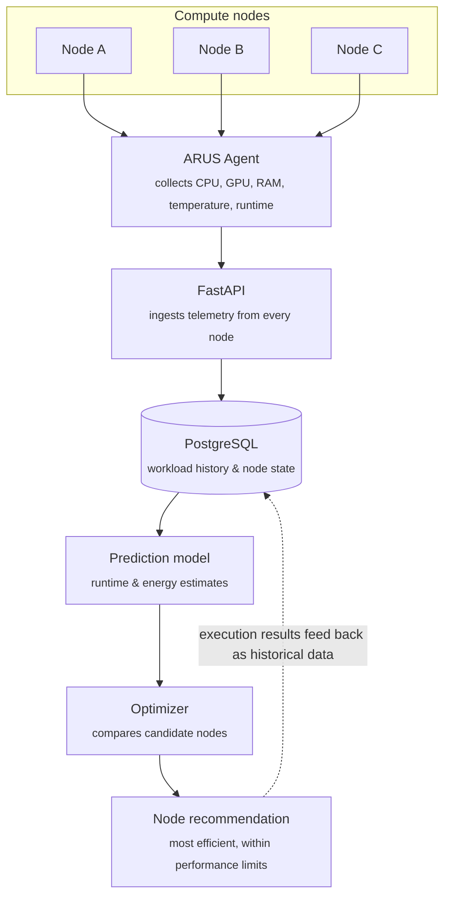

<div align="center">


# ARUS

**Energy-Aware Compute Intelligence: AI-driven workload placement for more energy-efficient compute.**

*Compute smarter. Waste less energy.*


**[📄 Pitch Deck (PDF)](docs/ARUS-Pitch-Deck.pdf)**

🇬🇧 English · 🇮🇩 [Bahasa Indonesia](README.id.md)

</div>

---

## Overview

ARUS turns workload placement from an **availability-based decision** into an **energy-efficiency-based decision**.

In most labs and compute fleets, a job runs on whichever machine is free, whichever is fastest, or whichever the operator is used to. The total energy needed to *finish* the job is rarely considered. ARUS learns how workloads behave on each piece of hardware, predicts the runtime and energy cost of a job on every candidate node, and recommends the feasible node with the **lowest predicted energy per job (Wh/job)** without violating performance requirements.

> **Project status:** ARUS is at the concept and MVP-design stage. This repository holds the pitch deck and the technical design. The validation plan below describes how the MVP is meant to be tested; results will be added once experiments are run.

## The Problem


- **Placement is driven by shortcuts.** Nodes are picked because they are idle, the fastest, or out of habit, not because they are the most efficient.
- **Lower power ≠ lower energy.** Energy to completion is *power × runtime*. A low-power machine can consume more total energy if it takes much longer to finish.
- **Fleets are increasingly heterogeneous.** Different CPUs, GPUs, RAM/VRAM and hardware generations give the same workload very different runtime and energy profiles.
- **Workloads differ.** AI training, inference, data processing and CPU batch jobs stress hardware in different ways, so no single node is optimal for everything.
- **Execution results are wasted.** Past runs are rarely fed back to improve the next placement decision.
- **Demand is rising fast.** According to the IEA, global data-center electricity consumption is projected to nearly double, from about 485 TWh in 2025 to about 950 TWh in 2030, driven largely by AI. Every efficiency gain in placement translates into lower cost and lower emissions.

## The Solution

ARUS is an **energy-aware decision engine** that sits in front of job execution:

1. **Understand the workload.** It reads the workload type, execution parameters and resource requirements.
2. **Profile every node.** It knows each node's CPU, GPU, RAM/VRAM and hardware capabilities.
3. **Read live node state.** It checks current availability and resource conditions, so decisions aren't based on spec sheets alone.
4. **Filter feasible nodes.** It keeps only the nodes with enough CPU, GPU, RAM and capacity for the job.
5. **Predict runtime and energy.** It estimates time to completion and energy consumption on each candidate.
6. **Recommend the most efficient node.** It picks the feasible node with the lowest predicted energy while respecting performance constraints.
7. **Learn from every run.** Actual runtime and energy are recorded and used to recalibrate the model over time.

## Architecture




### Tech Stack

| Layer | Technology |
|---|---|
| Agent & monitoring | Python · psutil · NVML |
| API | FastAPI |
| Database | PostgreSQL |
| Prediction model | scikit-learn |
| Dashboard | Streamlit |
| Deployment | Docker Compose |

The stack is lightweight, open-source and modular. It runs on existing infrastructure, which keeps the cost of early validation low.

## MVP Validation Plan

**Setup**

- The same workloads run on **three nodes with different hardware specs**.
- Each run records completion time, CPU/GPU/RAM utilization, temperature and estimated energy.
- Tests are repeated so results can be compared consistently across nodes.
- Where available, an **external power meter** provides ground-truth energy measurements.

**Metrics**

| Metric | Question it answers |
|---|---|
| Runtime prediction accuracy | How close is the predicted completion time to the actual one? |
| Energy prediction accuracy | How close is the predicted energy to the measured value? |
| Recommendation accuracy | Is the recommended node actually the more efficient choice? |
| Performance preservation | Are energy savings achieved without breaking performance targets? |

**Success criterion:** ARUS recommends placements that are more energy-efficient than simple baselines (*first idle node* and *fastest node*) while still meeting performance requirements.

## How ARUS Compares


ARUS does **not** replace existing schedulers or monitoring tools. It adds an energy-efficiency recommendation layer on top of them.

| Capability | Kubernetes / Slurm | Kepler | Carbon Aware SDK | **ARUS** |
|---|:---:|:---:|:---:|:---:|
| Workload placement | ✅ | — | ◐ | ✅ |
| Heterogeneous hardware support | ✅ | ◐ | — | ✅ |
| Energy monitoring | ◐ | ✅ | — | ✅ |
| Total energy to job completion | ◔ | ◔ | — | ✅ |
| Learning from execution history | — | — | — | ✅ |

<sub>✅ supported · ◐ partial · ◔ limited · — not supported</sub>

### Why it gets better with use

- **Operational data.** Every run adds real runtime and energy data across new workload × hardware combinations.
- **Continuous learning.** The gap between prediction and actual result is used to refine the model step by step.
- **Environment-specific calibration.** Each campus, lab or organization has its own hardware mix, and ARUS calibrates on local data.
- **Workflow integration.** It connects to existing node monitoring, databases, power meters and schedulers.

## Go-to-Market

| Stage | Segment | Focus |
|---|---|---|
| 1 · Validation | Campus AI / research lab | Build the initial dataset, test on heterogeneous machines, calibrate runtime and energy predictions |
| 2 · Early customer | Private AI / GPU lab | Validate on real AI workloads, CPU vs GPU node comparison, per-job efficiency |
| 3 · Commercial | Corporate GPU fleet | Placement for recurring workloads at scale, energy and cost savings |
| 4 · Scale | Medium compute infrastructure | Multi-node optimization integrated with existing monitoring and schedulers |

**Business model.** ARUS is software-first. Revenue grows with adoption: a free or subsidized **campus pilot** → a paid **corporate pilot** (setup and integration fee) → **production** (subscription per node per month, or an annual license) → **enterprise** (custom contracts, advanced integration, or savings-based pricing).

**MVP cost structure.** Three test machines and the backend run on existing hardware, the software stack is open-source, and development is founder-built. The next investment is a power meter for higher-quality validation.

## Roadmap


| Year | Milestone | Highlights | Managed nodes |
|---|---|---|---|
| 2026 | Early validation | Heterogeneous computer lab, initial workload / hardware / energy dataset | 3 |
| 2027 | End-to-end prototype | Telemetry + prediction model, automated placement recommendations | 10 |
| 2028 | Early deployment | Campus / private AI lab, efficiency dashboard, initial integration | 50 |
| 2029 | Commercialization | Subscription per node or site, corporate GPU fleets | 200 |
| 2030 | Scale & integration | Kubernetes / Slurm integration, carbon-aware and multi-site optimization | 1,000+ |

**2030 target:** ARUS becomes the decision layer for energy-efficient workload placement, integrated with monitoring and schedulers across heterogeneous compute environments.

## Repository Structure

```
ARUS/
├── README.md               # English documentation
├── README.id.md            # Indonesian documentation
└── docs/
    ├── ARUS-Pitch-Deck.pdf # Full pitch deck (12 slides, Indonesian)
    └── images/             # Slide previews used in this README
```

## Author

**Naufal Zaki**, concept, research and pitch deck.

---

<sub>© 2026 Naufal Zaki. All rights reserved. The ARUS concept, name and pitch materials may not be reused without permission.</sub>
