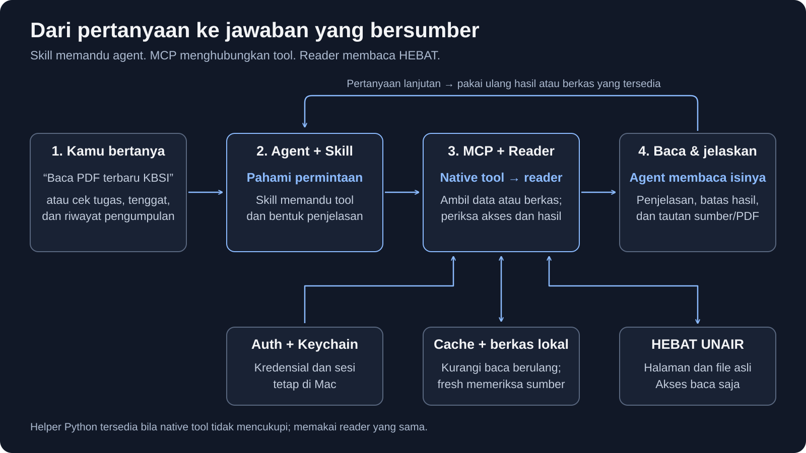

<div align="center">

# HEBAT MCP & Agent Skill

**Hubungkan agent AI dengan HEBAT UNAIR untuk memahami tugas, menentukan prioritas tenggat, menelusuri riwayat pengumpulan, dan membaca materi kuliah lewat percakapan.**

Server MCP lokal bersifat baca saja yang dipadukan dengan Agent Skill, dengan kredensial dan sesi login tetap tersimpan di macOS Keychain.


**[Panduan Pemasangan](docs/INSTALLATION.md)** · [Arsitektur](docs/ARCHITECTURE.md) · [Pengujian & Distribusi](docs/TESTING.md) · [Asal Proyek](docs/UPSTREAM.md)

🇬🇧 [English](README.md) · 🇮🇩 Bahasa Indonesia

</div>

---

## Ringkasan

Proyek ini memadukan **MCP lokal** untuk mengakses informasi kampus di **HEBAT UNAIR** dan **Agent Skill** untuk memandu cara agent membaca serta menjelaskan hasilnya. Instruksi tugas dan dokumen sumber diperiksa langsung sebelum diringkas, sementara kredensial dan sesi login tetap tersimpan aman di **macOS Keychain**.

## Mulai dari Pertanyaanmu

Setelah MCP dan skill dipasang, kamu bisa meminta:

- **Prioritas:** *"Cari tugas yang deadline-nya paling dekat sekarang."*
- **Penjelasan tugas:** *"Dalami tugas ini: ketentuannya apa, apa yang perlu disiapkan, dan bagaimana pengumpulannya?"*
- **Riwayat:** *"Tugas apa saja yang sudah kukumpulkan seminggu terakhir?"*
- **Materi:** *"Baca PDF terbaru KBSI, jelaskan ada tugas atau instruksi pengumpulan nggak, dan langsung kasih PDF-nya."*
- **Tindak lanjut:** *"Slide 5 maksudnya apa?"* atau *"Buka materi sebelum yang tadi."*

Jawaban tugas diarahkan untuk memuat ketentuan dosen, deadline, format berkas, aturan pengunggah, status akun, dan tautan sumber. Saat diminta mendalami, agent menjelaskan arti praktis persyaratan serta membedakan **kewajiban dosen, interpretasi, dan saran**. Ketentuan yang tidak tercantum tidak diisi dengan tebakan.

Untuk materi, berkas asli diambil dan dibaca sebelum diringkas. Tautan lokal langsung disertakan agar pengguna bisa membuka dokumen yang sama. Pertanyaan lanjutan dapat memakai berkas atau hasil pembacaan yang sudah tersedia.

## Kemampuan & Tool MCP

| Kebutuhan | Hasil | Tool MCP |
|---|---|---|
| **Menentukan prioritas** | Urutan tenggat, status, serta tugas terlambat yang dipisahkan | `hebat_priority` |
| **Memahami satu tugas** | Instruksi, deadline, status, aturan pengumpulan, dan tautan lampiran | `hebat_assignment_detail` |
| **Melihat riwayat** | Tugas berstatus terkumpul berdasarkan waktu perubahan terakhir | `hebat_submission_history` |
| **Membaca materi kelas** | Penemuan Resource, unduhan berkas, dan path lokal terverifikasi | `hebat_material` |
| **Menemukan kelas/aktivitas** | Daftar kelas dan tautan aktivitas | `hebat_courses`, `hebat_assignments` |
| **Memeriksa akses** | Ringkasan dashboard serta status sesi/build | `hebat_dashboard`, `hebat_status` |

Nama atau singkatan seperti **KBSI, ISIT, AVD, PAP, dan PPL** dicocokkan dengan kelas pada akun pengguna. Kelas teori, praktikum, dan paralel dibedakan. Jika hasil masih ambigu, agent perlu memperjelas kelasnya.

## Arsitektur Sistem

Agent mengikuti skill untuk memilih tool MCP yang sesuai dengan pertanyaanmu. Tool tersebut menjalankan reader untuk membaca HEBAT atau menggunakan cache yang masih layak. Reader mengembalikan data dan berkas asli; agent kemudian membaca isinya dan menyusun penjelasan beserta tautan sumber.



[Buka diagram ukuran penuh](docs/assets/how-hebat-works.svg)

| Komponen | Tanggung Jawab |
|---|---|
| **Skill** | Memandu agent: operasi mana yang dipilih, apa yang perlu dibaca, dan bagaimana menjelaskan hasilnya. |
| **MCP native & Reader** | Jalur pemanggilan tool langsung dari aplikasi agent; reader menjalankan pembacaan kelas, tugas, status, serta berkas materi. |
| **Auth & Keychain** | Menangani autentikasi; kredensial dan sesi tetap disimpan di Mac. |
| **Cache & berkas lokal** | Mengurangi pembacaan berulang. Berkas diperiksa sebelum dipakai ulang; `fresh` digunakan ketika sumber perlu diperbarui. |
| **Helper Python** | Menyediakan jalur CLI ketika operasi native tidak tersedia atau belum mencukupi, dengan logika reader yang sama. |

Satu runtime dapat digunakan oleh Codex dan Claude Code dengan proses MCP masing-masing. Lihat [arsitektur teknis](docs/ARCHITECTURE.md) untuk rincian komponennya.

## Pemasangan di Mac

**Kebutuhan:**
- Python **3.11+** pada macOS.
- Akun HEBAT UNAIR milik pengguna sendiri.
- Codex atau Claude Code dengan dukungan MCP lokal dan akses model yang sesuai (proyek ini tidak menyediakan akses model berbayar).

Dari direktori `HEBAT-UNAIR`, siapkan lingkungan Python:

```bash
python3 -m venv runtime/.venv
runtime/.venv/bin/python -m pip install -r runtime/requirements.txt
```

Lanjutkan [panduan pemasangan](docs/INSTALLATION.md) untuk:

1. Memasang skill pada aplikasi yang dipakai.
2. Mengikat lokasi Python dan server pada penunjuk runtime lokal.
3. Mendaftarkan MCP `hebat`.
4. Mengatur akun sendiri melalui Terminal dan memverifikasi koneksi.

## Status Pengujian & Batas Dukungan

| Bagian | Status |
|---|---|
| Reader / server | **2.3.2 / 0.4.2** |
| Native Codex | Pembacaan akun nyata diuji pada lingkungan pengembangan |
| Claude Code | Skill dikenali dan MCP terhubung; operasi protokol MCP serta file bersama diuji. **Percakapan penuh dengan model Claude belum terverifikasi** |
| Pemasangan pada Mac lain | Belum diverifikasi |
| Windows, Claude web, Claude Desktop | Belum termasuk pemasangan yang diuji pada proyek ini |

Hal yang perlu dipahami saat membaca hasil:

- Prioritas mencakup **aktivitas Assignment yang ditemukan**. Kuis, forum, aktivitas tersembunyi, dan tugas di luar HEBAT dapat tidak tercakup (hasil parsial diberi keterangan).
- Status akun sendiri belum membuktikan status kelompok jika pengumpulan cukup dilakukan oleh perwakilan. *"Belum dinilai"* dibedakan dari *"belum dikumpulkan"*.
- Riwayat memakai waktu perubahan terakhir, bukan log seluruh versi pengumpulan.
- Materi *"terakhir"* mengikuti urutan bagian/pertemuan dan aktivitas yang tersedia, bukan tanggal unggah.
- File lokal yang utuh belum membuktikan isi di URL sumber tidak berubah. Gunakan pembaruan sumber saat diperlukan.
- Struktur HTML atau SSO HEBAT dapat berubah; tes fixture tidak membuktikan seluruh kelas dan akun selalu kompatibel.

## Privasi & Batas Akses

- **Baca saja:** Seluruh operasi kampus bersifat baca saja. `POST` hanya digunakan untuk autentikasi. Tidak tersedia operasi unggah tugas, kirim pesan, ubah profil, atau hapus data kampus.
- **Kredensial lokal:** NIM/password diisi sendiri oleh pengguna di Terminal dan disimpan di Keychain bersama sesi. Jangan mengirim kredensial melalui chat. Hasil pembacaan HEBAT tetap diteruskan ke aplikasi agent untuk menyusun jawaban.
- **Pemisahan data:** Jangan commit atau membagikan cookie, `.session`, `.cache`, penunjuk runtime lokal, unduhan materi, keluaran akun, atau konfigurasi pribadi aplikasi agent.

## Struktur Proyek

```text
HEBAT-UNAIR/
├── runtime/
│   ├── hebat_mcp/            # reader, server MCP, auth, login, dan tes
│   ├── requirements.txt
│   └── tools/                # builder distribusi dan tesnya
├── skills/
│   └── hebat-unair/          # SKILL.md, helper, referensi, dan tes
├── docs/                     # pemasangan, arsitektur, pengujian, dan asal proyek
├── LICENSE
└── NOTICE.md
```

Reader pada runtime adalah sumber utama. Builder menyinkronkan salinannya pada skill dan memeriksa kesamaan hash. Lihat [pengujian dan distribusi](docs/TESTING.md) untuk menjalankan tes atau membuat paket.

## Lisensi & Sumber Awal

Proyek ini dikembangkan dari **[Arroyan23/MCP-Kampus](https://github.com/Arroyan23/MCP-Kampus)**, yang ditemukan melalui **[Glama](https://glama.ai/mcp/servers/Arroyan23/MCP-Kampus)**. Sumber awal menyediakan MCP HEBAT baca saja; pengembangan lanjutan menambahkan reader terstruktur, Keychain, cache, riwayat, pembacaan materi, helper, dan skill.

Lisensi **MIT**. Atribusi dan snapshot asal dicatat di [NOTICE.md](NOTICE.md) dan [asal proyek](docs/UPSTREAM.md).
