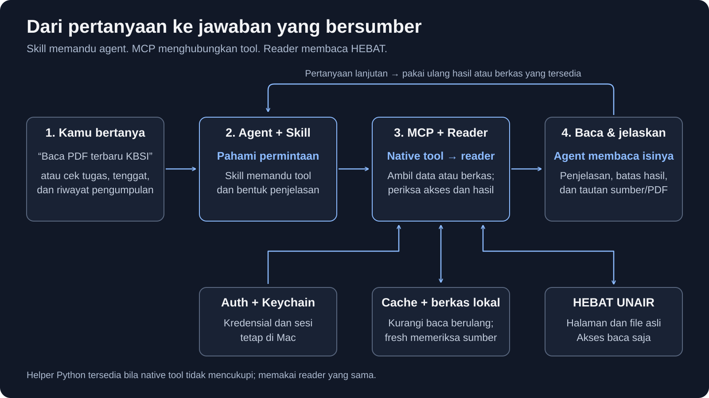

<div align="center">

# HEBAT MCP & Agent Skill

**Connect AI agents to HEBAT UNAIR for deadline prioritization, assignment breakdown, submission history, and course material reading via conversation.**

Read-only local MCP server paired with a reusable Agent Skill, keeping campus credentials and sessions securely in macOS Keychain.


**[Installation Guide](docs/INSTALLATION.md)** · [Architecture](docs/ARCHITECTURE.md) · [Testing & Distribution](docs/TESTING.md) · [Upstream Attribution](docs/UPSTREAM.md)

🇬🇧 English · 🇮🇩 [Bahasa Indonesia](README.id.md)

</div>

---

## Overview

HEBAT MCP & Agent Skill bridges AI coding/chat agents with **HEBAT UNAIR** (Universitas Airlangga's Moodle-based LMS). Instead of manually clicking through multiple course pages to track deadlines, verify submission rules, or hunt for the latest lecture PDF, you ask your agent in plain language and get grounded answers with direct links to source files.

The project combines two layers:
1. **Local MCP Server (`runtime/`):** Executes read-only authenticated requests against HEBAT, manages local caches, and downloads course files.
2. **Agent Skill (`skills/hebat-unair/`):** Guides the agent on which MCP tool to call, requires reading actual instructions/PDFs before summarizing, and enforces a clear distinction between lecturer requirements, interpretations, and suggestions.

## Example Prompts

Once the MCP server and skill are installed, you can ask:

- **Prioritization:** *"Find the assignments with the closest upcoming deadlines right now."*
- **Deep assignment breakdown:** *"Inspect this assignment: what are the exact requirements, file format, and submission rules?"*
- **Submission history:** *"Which assignments have I submitted in the past week?"*
- **Course materials:** *"Read the latest KBSI PDF, check whether there is a hidden task or submission rule, and give me the file link."*
- **Follow-up questions:** *"What does slide 5 mean?"* or *"Open the material right before the last one."*

## Capabilities & MCP Tools

| Use Case | Output | MCP Tool |
|---|---|---|
| **Deadline prioritization** | Sorted upcoming deadlines, submission status, and separated overdue tasks | `hebat_priority` |
| **Assignment inspection** | Lecturer instructions, due dates, file/uploader rules, account status, and attachments | `hebat_assignment_detail` |
| **Submission history** | Submitted assignments ordered by last modified timestamp | `hebat_submission_history` |
| **Course materials** | Resource discovery, file download, and verified local file paths | `hebat_material` |
| **Course & activity lookup** | Enrolled course list and activity links | `hebat_courses`, `hebat_assignments` |
| **Session diagnostics** | Dashboard overview, auth session state, and build status | `hebat_dashboard`, `hebat_status` |

Course abbreviations such as **KBSI, ISIT, AVD, PAP, and PPL** are matched against the user's enrolled courses, distinguishing theory, lab (*praktikum*), and parallel classes. If a query remains ambiguous, the agent asks for clarification rather than guessing.

## System Architecture

The agent follows the skill to choose the right MCP tool. The tool invokes the Python reader, which checks valid local caches or fetches live read-only data from HEBAT using sessions stored in macOS Keychain. The reader returns structured data and local file paths, which the agent inspects directly before replying.



[Open full-size diagram](docs/assets/how-hebat-works.svg)

| Component | Responsibility |
|---|---|
| **Agent Skill** | Guides tool selection, enforces source verification before summarizing, and structures responses. |
| **Native MCP Server** | Exposes structured read-only tools over `stdio` directly to Codex or Claude Code. |
| **Reader** | Parses courses, assignments, submission states, and downloads course resources. |
| **Auth & Keychain** | Handles SSO authentication and stores NIM/password plus session cookies inside macOS Keychain. |
| **Cache & Local Files** | Minimizes redundant LMS calls and reuses verified local PDFs for follow-up questions (`fresh` forces re-fetch). |
| **Python Helper** | Provides a CLI fallback path using the exact same reader logic when native MCP calls are unavailable. |

A single runtime can serve both Codex and Claude Code via separate MCP processes. See [docs/ARCHITECTURE.md](docs/ARCHITECTURE.md) for component-level details.

## Installation (macOS)

**Requirements:**
- **Python 3.11+** on macOS
- Your own **HEBAT UNAIR** student account
- **Codex** or **Claude Code** with local MCP support (this project does not supply paid LLM API access)

From the `HEBAT-UNAIR/` directory, set up the virtual environment:

```bash
python3 -m venv runtime/.venv
runtime/.venv/bin/python -m pip install -r runtime/requirements.txt
```

Follow [docs/INSTALLATION.md](docs/INSTALLATION.md) to complete setup:

1. Install the Agent Skill into your target client.
2. Bind the Python and MCP server paths to your local runtime pointer.
3. Register the `hebat` MCP server.
4. Sign in locally via Terminal (stored in macOS Keychain) and verify the connection.

## Testing Status & Support Boundaries

| Area | Status |
|---|---|
| Reader / MCP Server version | **2.3.2 / 0.4.2** |
| Native Codex | Verified with real account reads in the development environment |
| Claude Code | Skill recognized, MCP connected, protocol and shared files tested; **full end-to-end Claude model conversations remain unverified** |
| Installation on another Mac | Not yet verified |
| Windows, Claude Web, Claude Desktop | Outside currently tested targets |

### Known Limitations

- **Assignment scope:** Priority tracking covers detected Moodle **Assignment** activities. Quizzes, forums, hidden activities, and off-LMS tasks may not appear (partial coverage is explicitly flagged).
- **Group submissions:** Individual account status does not prove group submission status when a teammate submits on behalf of the group. *"Not graded"* is also distinguished from *"Not submitted"*.
- **History timestamps:** Submission history uses last-modified timestamps rather than full revision logs.
- **Latest material heuristic:** *"Latest"* follows course section/activity order rather than unavailable upload dates.
- **Upstream HTML/SSO changes:** Changes in HEBAT markup or SSO flow can affect parsers; fixture tests do not guarantee coverage for every course layout.

## Privacy & Security

- **Strictly read-only:** `POST` requests are used exclusively for authentication. There are no tools to upload assignments, send messages, edit profiles, or delete campus data.
- **Local credential storage:** NIM and password are entered locally in Terminal and stored in **macOS Keychain**. Never paste credentials into chat. Note that retrieved HEBAT content is sent to your configured AI client to generate answers.
- **Clean separation:** User data (cookies, `.session`, `.cache`, local runtime pointers, downloaded materials, and personal agent configs) must never be committed or shared.

## Project Structure

```text
HEBAT-UNAIR/
├── runtime/
│   ├── hebat_mcp/            # Reader, MCP stdio server, auth, login CLI, and tests
│   ├── requirements.txt
│   └── tools/                # Distribution builder and verification tests
├── skills/
│   └── hebat-unair/          # SKILL.md, Python helper, references, and tests
├── docs/                     # Installation, architecture, testing, and upstream notes
├── LICENSE
└── NOTICE.md
```

The reader inside `runtime/` is the single source of truth; the distribution builder syncs the skill copy and verifies hash parity. See [docs/TESTING.md](docs/TESTING.md) for running tests and building distribution packages.

## License & Upstream Attribution

Developed from **[Arroyan23/MCP-Kampus](https://github.com/Arroyan23/MCP-Kampus)** (discovered via **[Glama](https://glama.ai/mcp/servers/Arroyan23/MCP-Kampus)**). The upstream project provided read-only HEBAT MCP access; this project extends it with a structured reader, macOS Keychain storage, caching, submission history, material downloading, a Python helper, and an Agent Skill.

Licensed under the **MIT License**. Attribution and upstream snapshot details are recorded in [NOTICE.md](NOTICE.md) and [docs/UPSTREAM.md](docs/UPSTREAM.md).
