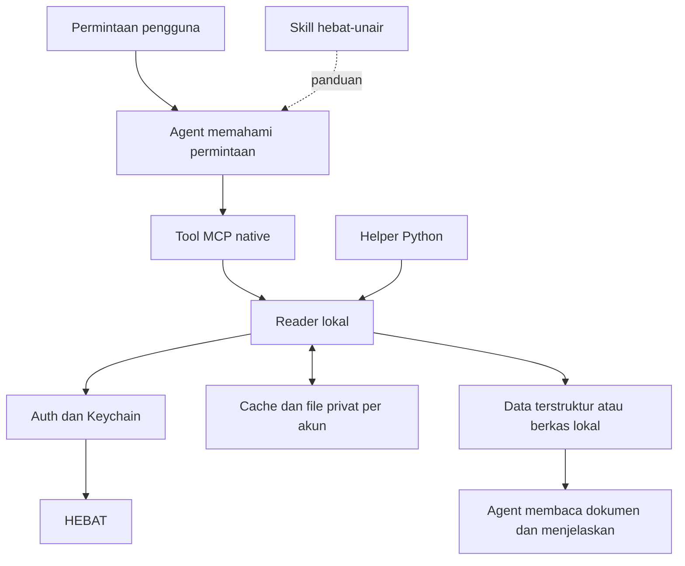

# Arsitektur

- **Skill** mengarahkan pemilihan operasi, pembacaan lampiran, pengungkapan ketidakpastian, serta format jawaban. Prompt tidak menggantikan batas akses dalam kode.
- **MCP server** menyediakan delapan tool melalui stdio; native berarti agent memanggil tool tersebut langsung.
- **Reader** menangani parsing halaman, pemilihan kelas, deadline/status, riwayat, serta pengambilan dan verifikasi materi.
- **Helper** menyediakan jalur CLI untuk operasi tambahan atau fallback yang memang diperlukan.
- **Auth/Keychain** menyimpan kredensial/sesi secara lokal, memeriksa identitas pemilik, serta membatasi pemulihan sesi.
- **Cache** menyimpan data akademik terparse dan rujukan file yang dapat dipakai ulang. `fresh` memeriksa sumber kembali. Hash yang valid hanya membuktikan file lokal utuh, bukan bahwa isi pada URL sumber belum berubah.

Reader tidak merangkum PDF secara semantik. Setelah file tersedia, agent memakai pembaca PDF/presentasi yang tersedia pada aplikasinya dan memberikan tautan file.

Format saat ini: sesi v2 dan cache schema 4. `.cache` serta `.session` dibuat lokal di runtime, terpisah dari sumber yang boleh dipublikasikan. Penunjuk `~/.config/hebat-unair/runtime.json` hanya memuat lokasi Python dan server.
