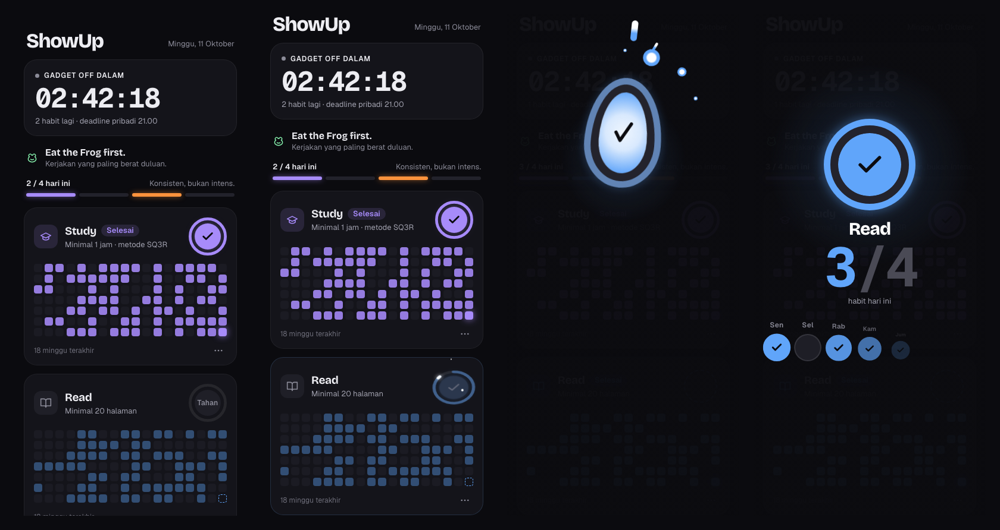
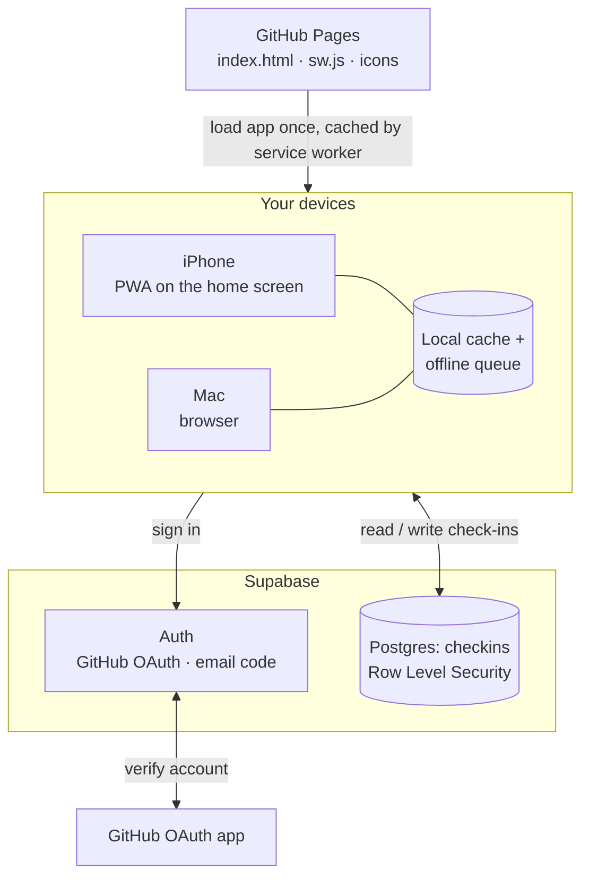

<div align="center">


# ShowUp

**A daily check-in app for four fixed habits. Hold to check in, watch the day light up, show up again tomorrow.**


**[Open the app](https://mnaufalzaki.github.io/Project-Portfolio/ShowUp-Web/)** · 🇬🇧 English · 🇮🇩 [Bahasa Indonesia](README.id.md)



</div>

---

## Overview

ShowUp is a deliberately small personal consistency tracker. It is not a habit manager: there is nothing to add, rename or configure. Four habits are fixed, each with a concrete daily target, and the only action is a deliberate press-and-hold.

It runs in the browser on a phone or a laptop, installs to the home screen as a Progressive Web App, keeps working offline, and syncs through Supabase so both devices always show the same day.

| Habit | Daily target |
|---|---|
| **Study** | At least 1 hour, using the SQ3R method |
| **Read** | At least 20 pages |
| **Wake Early** | Devices off at 21:00 · asleep by 22:00 · up at 05:00 |
| **P** | A private check-in, intentionally left unlabeled, confirmed before devices go off |

## Features

- **Hold to check in.** The ring charges over 3.4 seconds: the button compresses, the arc fills with a bright leading tip, specks gather in, and the last moments tremble, while a soft tone rises in pitch. Releasing early rewinds and records nothing.
- **A celebration with a result.** The pressed button lifts to centre stage, lights up, and the outcome lands beneath it: the day's count (for example 2/4 → 3/4) and the last seven days, with today filling in last. Then it flies home.
- **Consistency instead of streaks.** Each habit shows an 18-week heatmap. A missed day is one empty square, not a counter reset to zero.
- **A personal deadline.** The header counts down to 21:00, the "devices off" time. It warms from 19:00 when something is still open, turns urgent in the last 30 minutes, and switches to a calm "see you tomorrow" afterwards. The calendar day still rolls over at 00:00 local time.
- **Phone and laptop, one source of truth.** Installable PWA with an app-shell cache. Every change is written to a local queue first and synced when a connection is available.
- **Private by design.** One sign-in per device with GitHub or an email code/link, after which the session persists. Row Level Security limits every row to its owner.
- **Haptics where the platform allows.** `navigator.vibrate` on Android and the iOS 18 switch-haptic technique in Safari, both best-effort.
- **Accessible.** Keyboard check-in (Space or Enter on a focused ring), `prefers-reduced-motion` support, 44 px touch targets and a 12 px minimum text size.

## How it compares

ShowUp is built around one person's preferences, so the comparison is about trade-offs rather than a winner.

| | **ShowUp** | Streak-centric trackers (e.g. Streaks) | Gamified trackers (e.g. Habitica) | Open-source trackers (e.g. Loop Habit Tracker) |
|---|---|---|---|---|
| Core motivator | Seeing consistency accumulate | Not breaking the chain | Points, levels, party quests | Habit-strength score and charts |
| What happens on a missed day | One empty square | Streak resets to zero | Character takes damage | Score dips gradually |
| Setup | None: four fixed habits | Choose and configure tasks | Create habits, dailies, to-dos | Create and configure habits |
| Completion gesture | Deliberate 3.4 s hold | Tap or tap-and-hold | Tap | Tap |
| Evening wind-down | Built-in 21:00 deadline countdown | Reminders | Reminders | Reminders |
| Platforms | Any modern browser, installable on iOS and Android | Apple platforms | Web, iOS, Android | Android |
| Data | Your own Supabase project, offline queue | Vendor cloud sync | Vendor account | On-device |
| Cost | Free (Supabase free tier, GitHub Pages) | Paid app | Free with optional subscription | Free |

**Where ShowUp is stronger:** no guilt mechanics, zero configuration, an intentional check-in gesture that resists accidental taps, a deadline tied to a real sleep routine, and full ownership of the data on free infrastructure.

**Where it is weaker, by design or for now:** the habits cannot be customised, it is single-user, iOS haptics depend on a Safari technique rather than a native API, and reminders are not built in yet.

## Design decisions

These choices reflect personal preference and were made deliberately:

- **No streak counter anywhere.** Streaks motivate through loss aversion, which turns one missed day into a reason to quit, especially for a private habit. A heatmap rewards the long run.
- **Fixed habits.** Fewer decisions means less friction. The app is a commitment device, not a planner.
- **A long hold instead of a tap.** Checking in should feel like a small ritual and should never happen by accident.
- **The deadline is 21:00, not midnight.** Devices go off at 21:00 to protect the 22:00 bedtime and 05:00 wake-up, so the app nudges you before then and steps back afterwards.
- **"Eat the Frog first."** A standing reminder to do the hardest thing early in the day.
- **Dark interface, one colour per habit.** Colour is earned: a habit that is not done today is shown dimmed and becomes fully lit when you check in.

## Architecture

GitHub Pages serves the interface; Supabase holds sign-in and data. The two never talk to each other: each device loads the app from GitHub Pages and then talks to Supabase directly.



| Piece | Holds | Notes |
|---|---|---|
| GitHub Pages | The app files only | Public and static; no personal data. Updating the UI is a commit and push. |
| Service worker | A cached copy of the app shell | The app opens offline; the page is fetched fresh whenever the network is available. |
| Local cache and queue | Recent check-ins and unsynced changes | Check-ins made offline are replayed in order when the device reconnects. |
| Supabase Auth | Your account and sessions | GitHub sign-in, with an email code or pasted link as a fallback. One sign-in per device. |
| Supabase Postgres | The `checkins` table | Row Level Security limits every row to its owner. The publishable key in the client cannot bypass it. |

## Tech stack

| Layer | Choice |
|---|---|
| Front end | A single `index.html`: vanilla HTML, CSS animations and JavaScript, no build step |
| Fonts | Bricolage Grotesque, Geist, Geist Mono (Google Fonts) |
| Auth and data | Supabase Auth (email one-time code) and Postgres with Row Level Security |
| Client library | `@supabase/supabase-js` 2.45.4 from jsDelivr |
| Offline | Service worker app-shell cache, local cache and an operation queue in `localStorage` |
| Hosting | GitHub Pages |

### Data model

One row per habit per local calendar day:

```sql
checkins (
  user_id    uuid  default auth.uid(),
  habit      text  check (habit in ('study', 'read', 'wake', 'p')),
  day        date,
  created_at timestamptz,
  primary key (user_id, habit, day)
)
```

## Self-hosting

1. Create a Supabase project and run [`supabase/schema.sql`](supabase/schema.sql) in the SQL Editor.
2. Sign-in works with Supabase's default emails: type the code if the email contains one, or long-press the link, copy it and paste it into the app. Pasting matters on iOS, where the installed app's storage is separate from Safari. With a custom SMTP provider you can edit **Authentication → Emails → Magic link or OTP** to show `{{ .Token }}` as a six-digit code.
3. In **Authentication → URL Configuration**, set the Site URL to where you host the app.
4. Put your project URL and publishable (anon) key in the `SUPA_URL` and `SUPA_KEY` constants in `index.html`. The publishable key is safe to ship in client code; access is enforced by Row Level Security.
5. Host the folder on any static host (GitHub Pages is used here). After your first sign-in, disable new sign-ups in Supabase so no one else can create an account.

To preview the interface without signing in, open `index.html?state=idle` (demo data) or `index.html?state=done`.

## Project structure

```
ShowUp-Web/
├── index.html             # The whole app: UI, animations, data sync, auth
├── manifest.webmanifest   # PWA metadata
├── sw.js                  # Service worker (offline app shell)
├── icons/                 # App and home-screen icons
├── supabase/schema.sql    # Table and Row Level Security policies
└── docs/                  # README images
```

## Roadmap

- Web Push reminders at 19:00 and 20:30, sent only when a habit is still open.
- An optional weekly summary.

## Author

**Naufal Zaki** · [naufalzaki.tech](https://naufalzaki.tech) · [@mnaufalzaki](https://github.com/mnaufalzaki)
