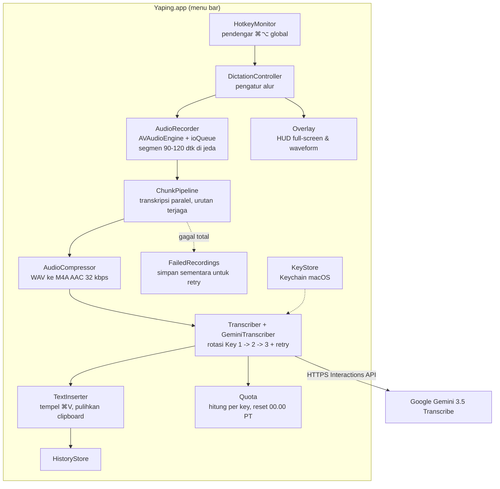

<div align="center">


# Yaping

**Aplikasi dikte suara gratis dan open source untuk macOS, ditenagai Google Gemini 3.5 Transcribe.**

Tekan <kbd>⌘</kbd><kbd>⌥</kbd>, bicara seperti biasa, tekan lagi, dan teks yang rapi lengkap dengan tanda baca langsung muncul di posisi kursormu.


**[⬇️ Download untuk Mac](https://github.com/mnaufalzaki/Project-Portfolio/releases/tag/yaping-v1.0.1)** · [Cerita di baliknya](docs/JOURNEY.id.md) · [Dokumentasi teknis (PDF)](docs/Dokumentasi%20Teknis%20Yaping.pdf)

🇬🇧 [English](README.md) · 🇮🇩 Bahasa Indonesia

</div>

---

## Tentang Yaping

Yaping adalah aplikasi menu bar ringan untuk macOS yang mengubah suaramu menjadi teks siap kirim di aplikasi apa pun: Notes, Google Docs, Slack, WhatsApp, Mail, VS Code, hingga Safari dalam mode layar penuh. Yaping dirancang untuk bahasa campuran Indonesia-Inggris dan berjalan langsung di atas **Google Gemini 3.5 Transcribe** (mode *smart*).

## Fitur

- **Hasil rapi, bukan transkrip mentah.** Dengan mode *smart* Gemini 3.5 Transcribe, kata pengisi ("eh", "emm") dan koreksi diri ("jam tiga, eh maksudnya jam empat") dirapikan otomatis sambil mempertahankan gaya bicaramu.
- **Cepat dan hemat bandwidth.** Audio 16 kHz mono dikompresi secara native ke **M4A (AAC 32 kbps)** sebelum dikirim ke cloud (ukuran turun ~7-10x dibanding WAV), menjaga waktu tunggu di kisaran **1-2 detik**.
- **Dikte panjang tanpa menunggu lama.** Rekaman panjang dipotong di jeda alami (*silence hysteresis* 400 ms) setiap **90-120 detik**, lalu diproses secara paralel selagi kamu masih bicara dengan urutan penempelan yang tetap terjaga.
- **Tampil di atas aplikasi Full Screen.** HUD indikator gelombang suara (*waveform*) menggunakan panel non-activating tingkat layar penuh agar tetap terlihat di atas Safari atau aplikasi full-screen lainnya tanpa mencuri fokus.
- **Dukungan 3 slot API key & pantauan kuota.** Mendukung hingga 3 slot API key Gemini di Keychain macOS dengan perpindahan otomatis jika satu key mencapai batas harian (*cooldown* mengikuti jam tunggu dari Google, reset harian di 00.00 Pacific Time / 15.00 WIB).
- **Anti-kehilangan rekaman.** Filter durasi bicara nyata mencegah tombol tertekan tidak sengaja membuang kuota. Jika koneksi terputus dan semua percobaan gagal, audio disimpan sementara agar bisa dicoba transkrip ulang dari menu bar.
- **Native dan ringan.** Dibangun murni dengan Swift/AppKit tanpa dependensi eksternal. API key disimpan aman di Keychain macOS.

## Instalasi

**Kebutuhan:** Mac dengan chip Apple Silicon (M1 atau lebih baru) dan macOS 14 atau lebih baru.

### Build dari source (disarankan untuk versi terbaru)

Butuh Xcode Command Line Tools (`xcode-select --install`). Aplikasi Xcode lengkap tidak diperlukan.

```bash
git clone https://github.com/mnaufalzaki/Project-Portfolio.git
cd Project-Portfolio/Yaping
./build.sh install
```

### Pengaturan pertama kali

1. **Berikan izin.** Di *System Settings › Privacy & Security*, nyalakan Yaping di **Accessibility** (di macOS 27 namanya *Device Control and Data Access*) dan **Input Monitoring**. Izinkan akses mikrofon saat diminta.
2. **Masukkan API key Gemini.** Klik ikon di menu bar › *Pengaturan* › *Mesin AI*, lalu tempel API key dari [Google AI Studio](https://aistudio.google.com/apikey) pada slot API Key 1 (opsional: isi juga Key 2 dan Key 3 sebagai cadangan).
3. **Mulai dikte.** Klik di kolom teks mana pun, tekan <kbd>⌘</kbd><kbd>⌥</kbd>, bicara, lalu tekan <kbd>⌘</kbd><kbd>⌥</kbd> lagi.

> [!NOTE]
> Build ditandatangani secara ad-hoc. Kalau kamu build dari source, macOS menganggap setiap build baru sebagai aplikasi baru, jadi izin Accessibility dan Input Monitoring perlu dinyalakan ulang setelah setiap pemasangan ulang.

## Cara pakai

| Shortcut | Aksi |
| --- | --- |
| <kbd>⌘</kbd><kbd>⌥</kbd> | Mulai merekam. Tombol tidak perlu ditahan. |
| <kbd>⌘</kbd><kbd>⌥</kbd> lagi | Selesai: teks ditranskripsi dan ditempel di kursor |
| <kbd>Esc</kbd> | Batalkan rekaman |
| <kbd>⌘</kbd><kbd>⌥</kbd> + tombol lain | Dianggap shortcut biasa (misalnya <kbd>⌘</kbd><kbd>⌥</kbd><kbd>D</kbd>), dan rekaman dibatalkan |

Mode tahan-untuk-bicara, tombol <kbd>Fn</kbd>, dan tombol modifier kanan tersedia di *Pengaturan › Umum*. Klik ikon di menu bar kapan saja untuk melihat sisa kuota harian, menempel ulang hasil terakhir, mencoba ulang rekaman yang gagal, atau membuka riwayat dikte.

## Arsitektur

Yaping berjalan sebagai satu proses native di menu bar dengan alur 1-hop langsung ke Google Gemini 3.5 Transcribe.



| Komponen | Tugas |
|---|---|
| `HotkeyMonitor` | Mendengarkan shortcut global untuk memulai atau menghentikan dikte. |
| `DictationController` | Mengatur satu sesi dikte dari awal sampai teks ditempel, termasuk filter hening dan coba ulang rekaman gagal. |
| `AudioRecorder` | Merekam audio 16 kHz mono di serial `ioQueue` (bebas disk I/O di audio thread) dan memotong segmen pada jeda >= 400 ms setelah 90-120 detik. |
| `AudioCompressor` | Mengonversi WAV ke M4A (AAC 32 kbps) secara native sebelum upload cloud agar ukuran payload ~7-10x lebih kecil. |
| `ChunkPipeline` | Mentranskripsi segmen secara paralel selagi kamu masih bicara sambil menjaga urutan output dan menyimpan segmen yang gagal. |
| `Transcriber` & `GeminiTranscriber` | Memanggil Gemini Interactions API secara berurutan melalui slot Key 1, Key 2, dan Key 3 dengan *cooldown* otomatis saat kena HTTP 429. |
| `Quota` | Mencatat pemakaian kuota per key dengan jadwal reset 00.00 Pacific Time (14.00/15.00 WIB). |
| `TextInserter` | Menempel teks di posisi kursor lewat clipboard, lalu memulihkan isi clipboard asli pengguna. |
| `Overlay` | Panel HUD non-activating (`screenSaver` level) dengan animasi waveform simetris yang tampil di atas aplikasi full-screen. |
| `KeyStore`, `HistoryStore`, `FailedRecordings` | Penyimpanan API key di Keychain macOS, riwayat dikte, dan cadangan sementara audio gagal. |

## Privasi

- API key disimpan di Keychain macOS, tidak pernah di file teks biasa.
- File audio sementara langsung dihapus begitu transkripsi selesai (kecuali saat gagal total, maksimal 5 file disimpan lokal untuk coba ulang).
- Log debug (`~/Library/Logs/Yaping.log`) hanya mencatat waktu proses dan jumlah kata, tidak pernah isi ucapanmu.
- Di tier gratis Google AI Studio, Google dapat menggunakan audio untuk meningkatkan produknya; aktifkan *Pay-As-You-Go* di Google Cloud Billing jika membutuhkan jaminan privasi penuh.

## Build dari source

Yaping di-compile langsung dengan `swiftc` lewat [`build.sh`](build.sh), tanpa proyek Xcode atau Swift Package.

<details>
<summary>Struktur proyek</summary>

```
Sources/Yaping/
├── YapingApp.swift            Titik masuk (+ mode --selftest)
├── AppDelegate.swift          Menu bar, main menu (⌘V/⌘C), jendela pengaturan
├── DictationController.swift  Alur rekam -> transkripsi -> tempel + retry gagal
├── ChunkPipeline.swift        Transkripsi segmen paralel dengan urutan terjaga
├── AudioRecorder.swift        Rekaman 16 kHz mono, serial ioQueue, silence hysteresis
├── AudioCompressor.swift      Kompresi native WAV ke M4A (AAC 32 kbps)
├── HotkeyMonitor.swift        Deteksi global ⌘⌥ / Fn / modifier
├── Transcriber.swift          Rotasi API key Gemini 1 -> 2 -> 3 + perapian spasi
├── Gemini.swift               Klien Gemini 3.5 Transcribe (Interactions API)
├── Quota.swift                Pantauan kuota per key, reset 00.00 Pacific Time
├── FailedRecordings.swift     Penyimpanan sementara audio gagal (maks 5 file)
├── TextInserter.swift         Tempel via ⌘V, spasi otomatis, pulihkan clipboard
├── Overlay.swift              HUD full-screen dengan animasi waveform simetris
├── SettingsView.swift         Pengaturan SwiftUI (Umum, Mesin AI, Riwayat)
└── …                          Settings, KeyStore, History, Log, Permissions, SelfTest
```

</details>

## Pembuat

Dibuat oleh **Naufal Zaki** ([naufalzaki.tech](https://naufalzaki.tech) · [@mnaufalzaki](https://github.com/mnaufalzaki)). Terinspirasi dari [Wispr Flow](https://wisprflow.ai/) dan ditenagai oleh [Google Gemini API](https://ai.google.dev/).

## Lisensi

Dirilis di bawah [Lisensi MIT](LICENSE). © 2026 Naufal Zaki.
