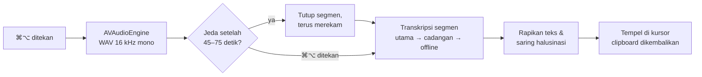

<div align="center">


# Yaping

**Aplikasi dikte suara gratis dan open source untuk macOS, terinspirasi dari Wispr Flow.**

Tekan <kbd>⌘</kbd><kbd>⌥</kbd>, bicara seperti biasa, tekan lagi, dan teks yang rapi lengkap dengan tanda baca langsung muncul di posisi kursormu.


**[⬇️ Download untuk Mac](https://github.com/mnaufalzaki/Yaping/releases/latest)** · [Cerita di baliknya](docs/JOURNEY.id.md)

🇬🇧 [English](README.md) · 🇮🇩 Bahasa Indonesia

</div>

---

## Tentang Yaping

Yaping adalah aplikasi menu bar ringan yang mengubah suaramu menjadi teks siap kirim di aplikasi apa pun: Notes, Google Docs, Slack, WhatsApp, Mail, VS Code, dan lainnya. Yaping dirancang untuk bahasa campuran Indonesia–Inggris, tapi bisa dipakai untuk bahasa apa pun yang didukung mesin transkripsi pilihanmu.

Kamu bebas memilih di mana audiomu diproses: Google Gemini untuk hasil paling rapi, Groq untuk kecepatan, atau whisper.cpp yang sepenuhnya offline sehingga audio tidak pernah keluar dari Mac. Semua pilihan punya versi gratis.

## Fitur

- **Hasil rapi, bukan transkrip mentah.** Dengan mode *smart* Gemini, kata pengisi ("eh", "emm") dan koreksi diri ("jam tiga, eh maksudnya jam empat") dirapikan otomatis, sementara kata-katamu tetap dipertahankan.
- **Dikte tanpa batas durasi.** Rekaman panjang dipotong di jeda bicara menjadi segmen sekitar 1 menit, lalu ditranskripsi *selagi kamu masih bicara*. Dalam pengujian, waktu tunggu setelah dikte 5 menit turun dari **143 detik menjadi 2,3 detik**.
- **Teks bertahap.** Untuk sesi panjang, teks bisa muncul per segmen sambil kamu bicara. Cocok untuk catatan rapat atau kuliah.
- **Banyak mesin, satu shortcut.** Pindah antara Gemini, Groq, whisper.cpp lokal, Apple Speech, atau endpoint apa pun yang kompatibel dengan OpenAI, langsung dari jendela Pengaturan.
- **Cadangan otomatis & pantauan kuota.** Pilih penyedia utama dan cadangan. Kalau penyedia utama kena batas kuota gratis atau internet bermasalah, Yaping langsung pindah, dan Whisper offline jadi cadangan terakhir. Sisa kuota harian dan jam reset-nya tampil di menu bar.
- **Kosakata pribadi.** Ajari Yaping nama, singkatan, dan istilah yang sering kamu pakai supaya ejaannya selalu benar.
- **Andal.** Setiap segmen dicoba ulang otomatis kalau gagal, Mac tidak tidur selama merekam, clipboard dikembalikan setelah menempel, dan "halusinasi" Whisper saat hening disaring.
- **Native dan ringan.** Dibangun murni dengan Swift/AppKit, memakai sekitar 190 MB RAM dan kurang dari 1% CPU saat diam. API key disimpan di Keychain macOS.

## Instalasi

**Kebutuhan:** Mac dengan chip Apple Silicon (M1 atau lebih baru) dan macOS 14 atau lebih baru.

### Pilihan A: Download (disarankan)

1. Download **`Yaping-1.0.zip`** dari [rilis terbaru](https://github.com/mnaufalzaki/Yaping/releases/latest), ekstrak, lalu seret **Yaping.app** ke folder **Applications**.
2. Buka Yaping. macOS akan memperingatkan bahwa aplikasi ini *"could not verify"*, karena aplikasi open source gratis tidak dinotarisasi oleh Apple. Buka **System Settings › Privacy & Security**, scroll ke bawah, lalu klik **Open Anyway**. Langkah ini cukup sekali.

### Pilihan B: Build dari source

Butuh Xcode Command Line Tools (`xcode-select --install`). Aplikasi Xcode lengkap tidak diperlukan.

```bash
git clone https://github.com/mnaufalzaki/Yaping.git
cd Yaping
./build.sh install
```

### Pengaturan pertama kali

1. **Berikan izin.** Di *System Settings › Privacy & Security*, nyalakan Yaping di **Accessibility** (di macOS 27 namanya *Device Control and Data Access*) dan **Input Monitoring**. Izinkan akses mikrofon saat diminta.
2. **Pilih mesin.** Klik ikon di menu bar › *Pengaturan* › *Mesin AI*, pilih penyedia, lalu tempel API key gratisnya. Untuk mesin offline, jalankan `./scripts/setup-local.sh` dari folder source.
3. **Mulai dikte.** Klik di kolom teks mana pun, tekan <kbd>⌘</kbd><kbd>⌥</kbd>, bicara, lalu tekan <kbd>⌘</kbd><kbd>⌥</kbd> lagi.

> [!NOTE]
> Build ditandatangani secara ad-hoc. Kalau kamu build dari source, macOS menganggap setiap build baru sebagai aplikasi baru, jadi izin perlu dinyalakan ulang setelah setiap pemasangan ulang.

## Cara pakai

| Shortcut | Aksi |
| --- | --- |
| <kbd>⌘</kbd><kbd>⌥</kbd> | Mulai merekam. Tombol tidak perlu ditahan. |
| <kbd>⌘</kbd><kbd>⌥</kbd> lagi | Selesai: teks ditranskripsi dan ditempel di kursor |
| <kbd>Esc</kbd> | Batalkan rekaman |
| <kbd>⌘</kbd><kbd>⌥</kbd> + tombol lain | Dianggap shortcut biasa (misalnya <kbd>⌘</kbd><kbd>⌥</kbd><kbd>D</kbd>), dan rekaman dibatalkan |

Mode tahan-untuk-bicara, tombol <kbd>Fn</kbd>, dan tombol modifier kanan tersedia di *Pengaturan › Umum*. Klik ikon di menu bar kapan saja untuk melihat sisa kuota harian, menempel ulang hasil terakhir, atau melihat riwayat dikte.

## Mesin transkripsi

| Mesin | Paling cocok untuk | Kecepatan* | Privasi | API key |
| --- | --- | --- | --- | --- |
| **Gemini 3.5 Transcribe** | Teks paling rapi; mode smart; kosakata hingga 1.000 istilah | ~3 detik | Cloud. Di tier gratis, Google boleh memakai audio untuk meningkatkan produknya. | [Google AI Studio](https://aistudio.google.com/apikey) |
| **Groq** (Whisper large-v3) | Paling cepat | ~1 detik | Cloud | [Groq Console](https://console.groq.com/keys) |
| **whisper.cpp** (lokal) | Offline, privat, tanpa batas | ~1,5–3 detik | Audio tidak keluar dari Mac | Tidak perlu |
| **Apple Speech** | Tanpa pengaturan | Cepat | Di perangkat | Tidak perlu |
| **Custom** | Endpoint `/audio/transcriptions` apa pun yang kompatibel dengan OpenAI | Bervariasi | Tergantung penyedia | Bervariasi |

<sub>*Waktu tunggu umum setelah selesai bicara, diukur di MacBook M3. Dikte yang lebih panjang tetap di kisaran yang sama berkat pemotongan segmen.</sub>

Tersedia juga perapian/parafrase AI opsional (Groq, Claude, atau Ollama), tapi dimatikan secara bawaan. Mode smart Gemini sudah merapikan teks tanpa mengubah gaya bicaramu.

### Cadangan otomatis & kuota

Tier gratis punya batas. Dalam pengujian kami, tier gratis Gemini 3.5 Transcribe hanya mengizinkan **25 request per hari**. Karena itu, di *Pengaturan › Mesin AI* kamu bisa menentukan penyedia **utama** dan **cadangan**, ditambah cadangan terakhir yang offline:

```
Gemini (utama) ──gagal──▶ Groq (cadangan) ──gagal──▶ whisper.cpp lokal (offline)
```

- **Pindah otomatis.** Kalau satu penyedia kena batas kuota, error, belum punya API key, atau internet putus, penyedia berikutnya langsung mengambil alih untuk segmen itu. Pesan singkat memberi tahu penyedia mana yang dipakai dan alasannya.
- **Jeda pintar.** Saat penyedia menyatakan kuotanya habis, Yaping membaca jam tunggu persis dari jawabannya (misalnya *"retry in 10h59m"*) dan melewati penyedia itu sampai waktunya tiba. Dengan begitu, tidak ada waktu terbuang untuk request yang pasti ditolak. Status ini tetap diingat walaupun aplikasi ditutup.
- **Sisa kuota langsung terlihat.** Menu bar dan Pengaturan menampilkan sisa kuota hari ini, plus peringatan di dalam aplikasi saat kuota hampir habis:

  ```
  Kuota hari ini
     Gemini: ±18 / 25 tersisa · reset 07.00
     Groq: 1.990 / 2.000 tersisa · reset 20.45
  ```

  Angka Groq akurat karena dibaca dari header rate-limit-nya. Gemini tidak memberi tahu sisa kuota, jadi Yaping menghitung request-nya sendiri (ditandai **±**). Hitungan direset tengah malam UTC (07.00 WIB), dan otomatis dikoreksi oleh jawaban Google begitu batasnya tercapai.

## Cara kerja



Segmen diproses berurutan. Setiap segmen melewati rantai penyedia, dan dicoba ulang sekali kalau semua penyedia gagal, jadi teks akhirnya lengkap dan urutannya benar. Saat kamu berhenti, hanya segmen terakhir yang belum diproses. Itulah sebabnya waktu tunggu tetap singkat, berapa pun lamanya kamu bicara.

## Hasil pengujian

Diukur di MacBook Apple M3 selama pengembangan Yaping. Cerita lengkap beserta semua tesnya ada di [Cerita di balik Yaping](docs/JOURNEY.id.md).

| Tes | Hasil |
| --- | --- |
| Dikte 5 menit, sebelum vs sesudah pemotongan otomatis | Menunggu setelah selesai: **143 detik → 2,3 detik** (7 segmen, 0 gagal) |
| Gemini vs Groq, pembicara yang sama | Gemini: tanda baca rapi, nama merek benar · Groq: lebih cepat, tapi jadi satu kalimat panjang |
| Waktu proses Gemini vs durasi audio | 24 dtk → 3 dtk · 59 dtk → 8 dtk · 85 dtk → 15 dtk · 5 menit → 143 dtk (alasan segmen ±1 menit) |
| Kegagalan ganda di pemakaian nyata | Kuota Gemini habis **dan** Wi-Fi putus di tengah request → Whisper offline menyerahkan semua 129 kata |
| Beban saat diam | ~190 MB RAM, ~0,5% CPU |

## Privasi

- API key disimpan di Keychain macOS, tidak pernah di file biasa.
- Audio disimpan sebagai file sementara yang langsung dihapus setelah ditranskripsi.
- Log debug (`~/Library/Logs/Yaping.log`) hanya mencatat waktu proses dan jumlah kata, tidak pernah isi ucapanmu.
- Penghitung kuota disimpan di Mac dan hanya berisi jumlah request.
- Untuk privasi penuh, pakai mesin whisper.cpp lokal. Dengan mesin itu, Yaping tidak mengirim apa pun ke internet untuk transkripsi.

## Mengatasi masalah

| Masalah | Solusi |
| --- | --- |
| Tidak ada reaksi saat menekan <kbd>⌘</kbd><kbd>⌥</kbd> | Nyalakan ulang Yaping di Accessibility dan Input Monitoring (wajib setelah setiap pemasangan ulang). |
| Muncul "Teks disalin — tekan ⌘V" | Izin Accessibility belum ada, jadi teks disalin ke clipboard alih-alih ditempel. |
| Nama atau singkatan salah eja | Tambahkan di *Pengaturan › Kosakata*. |
| Muncul "Pakai cadangan — Gemini: kuota habis …" | Normal: kuota gratis harian Gemini sudah habis, jadi penyedia cadangan yang mentranskripsi. Gemini otomatis dipakai lagi setelah jam reset yang tertera di menu bar. |
| Kuota Gemini menunjukkan sisa "±" tapi request ditolak | Perkiraan hanya menghitung request dari Yaping. Kalau key yang sama dipakai di tempat lain, penolakan pertama akan mengoreksi angkanya. |
| Ingin menguji tanpa mikrofon | `/Applications/Yaping.app/Contents/MacOS/Yaping --selftest rekaman.wav` |

## Build dari source

Yaping di-compile langsung dengan `swiftc` lewat [`build.sh`](build.sh), tanpa proyek Xcode atau Swift Package. Skrip build memakai sertifikat Apple Development kalau ada, dan kalau tidak ada, memakai tanda tangan ad-hoc. `./scripts/package.sh` membuat file zip rilis di `dist/`.

<details>
<summary>Struktur proyek</summary>

```
Sources/Yaping/
├── YapingApp.swift            Titik masuk (+ mode --selftest)
├── AppDelegate.swift          Menu bar, jendela pengaturan, alur izin
├── DictationController.swift  Alur rekam → transkripsi → tempel
├── ChunkPipeline.swift        Transkripsi segmen berurutan + coba ulang
├── AudioRecorder.swift        Rekaman 16 kHz mono, pemotongan di jeda
├── HotkeyMonitor.swift        Deteksi global ⌘⌥ / Fn / modifier
├── Transcriber.swift          Rantai penyedia + cadangan, perapian transkrip, API Whisper
├── Quota.swift                Pantauan kuota gratis, jam reset, dan jeda
├── Gemini.swift               Gemini 3.5 Transcribe (Interactions API)
├── Groq.swift                 Deteksi model chat untuk perapian opsional
├── LocalEngines.swift         Server whisper.cpp & klien Ollama
├── TextCleaner.swift          Perapian AI opsional
├── TextInserter.swift         Tempel via ⌘V, spasi otomatis, kembalikan clipboard
├── Overlay.swift              Indikator gelombang suara
├── SettingsView.swift         Pengaturan (SwiftUI)
└── …                          Settings, KeyStore, History, Log, Permissions
```

</details>

## Pembuat

Dibuat dalam satu hari oleh **Naufal Zaki** ([naufalzaki.tech](https://naufalzaki.tech) · [@mnaufalzaki](https://github.com/mnaufalzaki)), yang merancang dan menguji setiap langkah, sebagian besar lewat suara memakai Yaping sendiri, dengan [Claude Code](https://claude.com/claude-code) sebagai rekan pemrograman. Baca [cerita di balik Yaping](docs/JOURNEY.id.md).

## Terima kasih kepada

- [whisper.cpp](https://github.com/ggml-org/whisper.cpp) dan model [Whisper](https://github.com/openai/whisper) dari OpenAI
- [Google Gemini API](https://ai.google.dev/) dan [Groq](https://groq.com/)
- Terinspirasi dari [Wispr Flow](https://wisprflow.ai/)

## Lisensi

Dirilis di bawah [Lisensi MIT](LICENSE). © 2026 Naufal Zaki.
