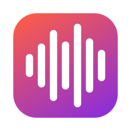
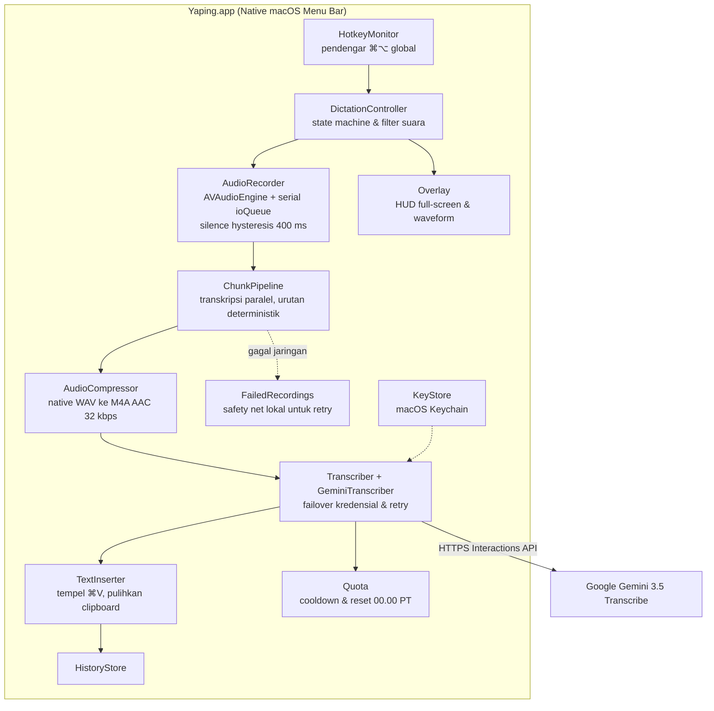
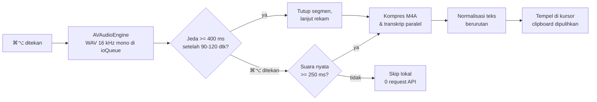

<div align="center">



# Yaping

**Aplikasi dikte suara native dan open source untuk macOS, ditenagai Google Gemini 3.5 Transcribe.**

Tekan <kbd>⌘</kbd><kbd>⌥</kbd>, bicara seperti biasa, tekan lagi, dan teks rapi lengkap dengan tanda baca langsung muncul di posisi kursormu.


**[⬇️ Download untuk Mac](https://github.com/mnaufalzaki/Project-Portfolio/releases/tag/yaping-v1.0.1)** · [Cerita di baliknya](docs/JOURNEY.id.md) · [Dokumentasi teknis (PDF)](docs/Dokumentasi%20Teknis%20Yaping.pdf)

🇬🇧 [English](README.md) · 🇮🇩 Bahasa Indonesia

</div>

---

## Tentang Yaping

Yaping adalah aplikasi menu bar native untuk macOS yang mengubah suara menjadi teks siap kirim di aplikasi apa pun: Notes, Google Docs, Slack, WhatsApp, Mail, VS Code, hingga Safari dalam mode layar penuh. Yaping dirancang khusus untuk pola bicara campuran Indonesia-Inggris dengan latensi rendah dan arsitektur audio-ke-teks yang efisien.

## Sorotan Rekayasa & Fitur Utama

- **Transkripsi cerdas tanpa pemrosesan ganda.** Memanfaatkan **Google Gemini 3.5 Transcribe** (mode *smart*) langsung dalam satu jalur (*1-hop*): kata pengisi ("eh", "emm") dibuang dan koreksi diri ("jam tiga, eh maksudnya jam empat") dirapikan otomatis tanpa mengubah gaya bahasa asli pembicara.
- **Kompresi audio native untuk latensi rendah.** Rekaman 16 kHz mono WAV dikompresi secara native di macOS ke **M4A (AAC 32 kbps)** sebelum dikirim ke cloud (ukuran payload turun **~7-10x** dalam ~28 ms di Apple Silicon), menjaga waktu tunggu di kisaran **1-2 detik**.
- **Pipeline audio bebas blokir (*lock-free audio tap*).** Seluruh penulisan disk, konversi *sample rate*, dan rotasi segmen dipindahkan ke serial `ioQueue` terpisah sehingga *real-time audio thread* tidak pernah mengalami *dropout*.
- **Segmentasi adaptif & transkripsi paralel.** Rekaman panjang dipotong pada jeda bicara nyata (*silence hysteresis* 400 ms) setiap **90-120 detik**, lalu diunggah dan ditranskripsi secara paralel selagi pengguna masih bicara sambil menjaga urutan penempelan yang deterministik.
- **HUD Full-Screen tanpa mencuri fokus.** Indikator gelombang suara (*waveform*) dibangun di atas subclass `NSPanel` non-activating (`screenSaver` level, `fullScreenAuxiliary`, `hidesOnDeactivate = false`) sehingga tetap tampil di atas aplikasi full-screen seperti Safari tanpa memicu perpindahan Space.
- **Ketahanan operasional (*fault tolerance*).** Dilengkapi filter durasi bicara nyata untuk mencegah request kosong akibat tombol tertekan tidak sengaja, *retry* otomatis per segmen, *cooldown* berbasis jadwal reset Pacific Time, pemulihan clipboard tahan *race condition*, serta *safety net* penyimpanan lokal jika seluruh percobaan jaringan gagal.
- **Native dan ringan.** Dibangun murni dengan Swift 5, AppKit, SwiftUI, dan AVFoundation tanpa dependensi pihak ketiga. Kredensial API disimpan secara lokal di `~/Library/Application Support/Yaping/keys.json` dengan izin akses khusus pemilik (`chmod 600`).

## Instalasi

**Kebutuhan:** Mac dengan chip Apple Silicon (M1 atau lebih baru) dan macOS 14 atau lebih baru.

### Build dari source

Membutuhkan Xcode Command Line Tools (`xcode-select --install`). Aplikasi Xcode lengkap tidak diperlukan.

```bash
git clone https://github.com/mnaufalzaki/Project-Portfolio.git
cd Project-Portfolio/Yaping
./build.sh install
```

### Pengaturan pertama kali

1. **Berikan izin sistem.** Di *System Settings › Privacy & Security*, aktifkan Yaping pada **Accessibility** (di macOS 27 bernama *Device Control and Data Access*) dan **Input Monitoring**. Izinkan akses mikrofon saat diminta.
2. **Hubungkan API key Gemini.** Klik ikon Yaping di menu bar › *Pengaturan* › *Mesin AI*, lalu masukkan API key dari [Google AI Studio](https://aistudio.google.com/apikey).
3. **Mulai dikte.** Klik di kolom teks mana pun, tekan <kbd>⌘</kbd><kbd>⌥</kbd>, bicara, lalu tekan <kbd>⌘</kbd><kbd>⌥</kbd> lagi.

> [!NOTE]
> Build dari source ditandatangani secara ad-hoc. macOS menganggap setiap build ad-hoc baru sebagai aplikasi baru, sehingga izin Accessibility dan Input Monitoring perlu diaktifkan ulang setelah pemasangan ulang.

## Cara pakai

| Shortcut | Aksi |
| --- | --- |
| <kbd>⌘</kbd><kbd>⌥</kbd> | Mulai merekam (mode toggle, tombol tidak perlu ditahan) |
| <kbd>⌘</kbd><kbd>⌥</kbd> lagi | Selesai: audio dikompresi, ditranskripsi, dan ditempel di posisi kursor |
| <kbd>Esc</kbd> | Batalkan rekaman yang sedang berjalan |
| <kbd>⌘</kbd><kbd>⌥</kbd> + tombol lain | Dianggap shortcut biasa (misalnya <kbd>⌘</kbd><kbd>⌥</kbd><kbd>D</kbd>), rekaman dibatalkan |

Mode tahan-untuk-bicara (*hold-to-talk*), tombol <kbd>Fn</kbd>, dan tombol modifier kanan tersedia di *Pengaturan › Umum*. Klik ikon menu bar kapan saja untuk memantau kuota harian, menempel ulang hasil terakhir, mencoba ulang rekaman gagal, atau membuka riwayat dikte.

## Arsitektur Sistem

Yaping berjalan sebagai satu proses native di menu bar dengan pemisahan tanggung jawab yang jelas antara *audio capture*, *compression*, *concurrent pipeline*, *credential failover*, dan *system-wide text injection*.



| Komponen | Tanggung Jawab |
|---|---|
| `HotkeyMonitor` | Mendengarkan shortcut global dan membedakan dikte dari kombinasi shortcut aplikasi lain. |
| `DictationController` | Mengatur siklus sesi dikte, filter durasi suara nyata, status HUD, dan aksi coba ulang rekaman gagal. |
| `AudioRecorder` | Merekam audio 16 kHz mono, memindahkan seluruh konversi & disk I/O ke serial `ioQueue`, dan memotong segmen pada jeda >= 400 ms setelah 90-120 detik. |
| `AudioCompressor` | Mengonversi WAV ke M4A (AAC 32 kbps) secara native via CoreAudio dengan fallback otomatis ke WAV jika diperlukan. |
| `ChunkPipeline` | Menjalankan transkripsi segmen secara paralel selagi pengguna berbicara sambil menjaga urutan output dan penempelan bertahap. |
| `Transcriber` & `GeminiTranscriber` | Mengelola panggilan Gemini Interactions API, *failover* kredensial, normalisasi teks, dan penanganan respons hening tanpa error palsu. |
| `Quota` | Memantau estimasi pemakaian harian, membaca durasi tunggu dari respons HTTP 429, dan menyinkronkan reset harian pada 00.00 Pacific Time. |
| `TextInserter` | Menyisipkan teks di kursor lewat `CGEvent` (`⌘V`) dengan spasi otomatis berbasis Accessibility dan pemulihan clipboard asli yang aman dari *race condition*. |
| `Overlay` | Panel HUD non-activating (`screenSaver` level) dengan animasi waveform simetris yang tetap muncul di atas aplikasi full-screen. |
| `KeyStore`, `HistoryStore`, `FailedRecordings` | Penyimpanan kredensial di Keychain macOS, riwayat dikte dengan salin cepat, dan cadangan sementara audio gagal (maksimal 5 file). |

## Alur Kerja End-to-End



## Hasil Pengujian

Diukur di MacBook Air Apple M3 dalam pemakaian harian:

| Pengujian | Hasil Terukur |
| --- | --- |
| Kompresi native `AudioCompressor` (WAV 10 dtk 16 kHz mono) | **324 KB -> 44,5 KB (7,3x lebih kecil)** dalam **27,8 ms** |
| Dikte pendek & menengah (5-47 dtk) | Waktu tunggu **1,0-1,8 detik** setelah berhenti bicara |
| Dikte panjang (83,8 dtk, 97 kata) | Waktu tunggu **1,57 detik** setelah berhenti bicara |
| Ketekan tombol tidak sengaja (< 0,5 dtk / tanpa suara) | Di-skip lokal di Mac (**0 request API**, 0 halusinasi) |
| Beban saat diam | Ringan, native Swift/AppKit tanpa proses server lokal |

## Privasi & Keamanan

- Seluruh API key disimpan secara lokal di `~/Library/Application Support/Yaping/keys.json` dengan izin `0600` (hanya dapat dibaca akun macOS pemilik, berada di luar folder repositori).
- File audio sementara langsung dihapus setelah transkripsi berhasil; hanya segmen yang gagal total yang disimpan sementara secara lokal (maksimal 5 file) agar pengguna bisa mencoba ulang.
- Log debug (`~/Library/Logs/Yaping.log`) hanya mencatat durasi, jumlah kata, dan waktu proses, tidak pernah mencatat isi ucapan.
- Audio dikirim langsung dari Mac ke endpoint resmi Google Gemini API via HTTPS. Untuk jaminan privasi data penuh (tidak digunakan untuk peningkatan produk), aktifkan *Pay-As-You-Go* pada project Google Cloud Billing.

## Mengatasi Masalah

| Masalah | Solusi |
| --- | --- |
| Tidak ada reaksi saat menekan <kbd>⌘</kbd><kbd>⌥</kbd> | Aktifkan ulang Yaping di *Accessibility* dan *Input Monitoring* (diperlukan setelah setiap build ulang ad-hoc). |
| Muncul pesan *"Teks disalin — tekan ⌘V"* | Izin Accessibility belum aktif, sehingga teks disalin ke clipboard alih-alih ditempel otomatis. |
| Rekaman gagal karena koneksi terputus | Klik ikon menu bar › *Coba Ulang Rekaman Gagal* begitu koneksi kembali normal. |
| Menguji pipeline tanpa mikrofon | `/Applications/Yaping.app/Contents/MacOS/Yaping --selftest rekaman.wav` |

## Struktur Proyek

Yaping dikompilasi langsung menggunakan `swiftc` melalui [`build.sh`](build.sh) tanpa proyek Xcode atau Swift Package Manager.

<details>
<summary>Lihat daftar file sumber</summary>

```
Sources/Yaping/
├── YapingApp.swift            Titik masuk aplikasi (+ mode --selftest)
├── AppDelegate.swift          Menu bar, main menu (⌘V/⌘C/⌘A), jendela pengaturan
├── DictationController.swift  State machine rekam -> transkrip -> tempel + retry gagal
├── ChunkPipeline.swift        Transkripsi segmen paralel dengan urutan deterministik
├── AudioRecorder.swift        Rekaman 16 kHz mono, serial ioQueue, silence hysteresis
├── AudioCompressor.swift      Kompresi native CoreAudio WAV ke M4A (AAC 32 kbps)
├── HotkeyMonitor.swift        Deteksi shortcut global ⌘⌥ / Fn / modifier kanan
├── Transcriber.swift          Orkestrasi transkripsi, failover kredensial, normalisasi
├── Gemini.swift               Klien Google Gemini 3.5 Transcribe (Interactions API)
├── Quota.swift                Pantauan kuota, cooldown HTTP 429, reset 00.00 PT
├── FailedRecordings.swift     Penyimpanan lokal audio gagal untuk retry (maks 5 file)
├── TextInserter.swift         Tempel ⌘V, spasi otomatis, pemulihan clipboard aman
├── Overlay.swift              HUD non-activating full-screen & animasi waveform
├── SettingsView.swift         Antarmuka Pengaturan SwiftUI (Umum, Mesin AI, Riwayat)
└── …                          Settings, KeyStore, History, Log, Permissions, SelfTest
```

</details>

## Pembuat

Dirancang dan dibangun oleh **Naufal Zaki** ([naufalzaki.tech](https://naufalzaki.tech) · [@mnaufalzaki](https://github.com/mnaufalzaki)). Terinspirasi dari [Wispr Flow](https://wisprflow.ai/) dan ditenagai oleh [Google Gemini API](https://ai.google.dev/).

## Lisensi

Dirilis di bawah [Lisensi MIT](LICENSE). © 2026 Naufal Zaki.
