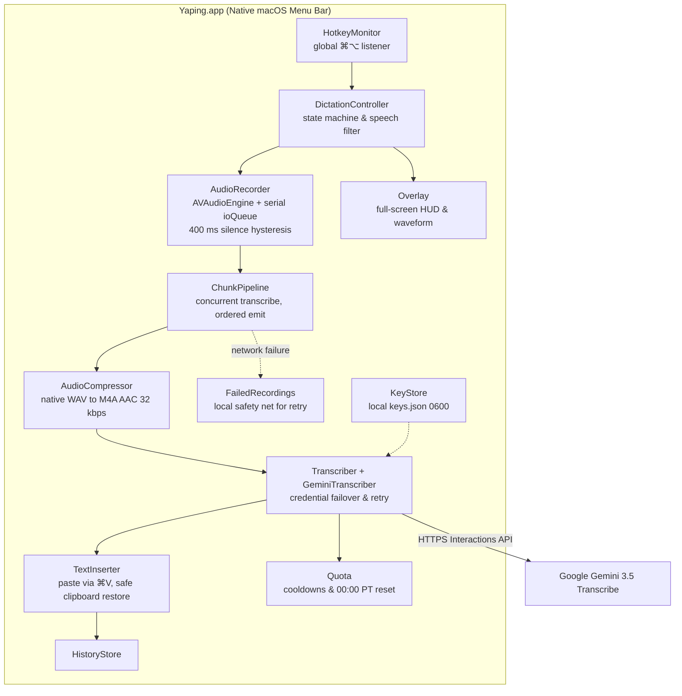
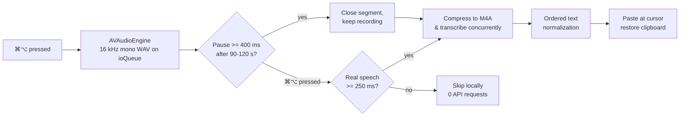

<div align="center">


# Yaping

**Native, open-source voice dictation for macOS, powered by Google Gemini 3.5 Transcribe.**

Press <kbd>⌘</kbd><kbd>⌥</kbd>, speak naturally, press again, and clean, punctuated text appears wherever your cursor is.


**[⬇️ Download for Mac](https://github.com/mnaufalzaki/Project-Portfolio/releases/tag/yaping-v1.0.1)** · [The story behind it](docs/JOURNEY.md) · [Technical docs (PDF, Indonesian)](docs/Dokumentasi%20Teknis%20Yaping.pdf)

🇬🇧 English · 🇮🇩 [Bahasa Indonesia](README.id.md)

</div>

---

## Overview

Yaping is a lightweight native menu-bar app for macOS that turns speech into ready-to-send text in any application: Notes, Google Docs, Slack, WhatsApp, Mail, VS Code, and full-screen Safari. Engineered for mixed Indonesian-English speech with low-latency cloud audio compression and a clean single-hop transcription architecture.

## Engineering Highlights & Features

- **Clean single-hop transcription.** Uses **Google Gemini 3.5 Transcribe** (*smart* mode) directly without a secondary LLM pass: filler words ("uh", "um") are stripped and self-corrections ("at three, sorry, at four") are resolved automatically while keeping the speaker's natural phrasing.
- **Native cloud audio compression.** 16 kHz mono WAV recordings are compressed natively on macOS to **M4A (AAC 32 kbps)** before upload (**~7-10x smaller payload** in ~28 ms on Apple Silicon), keeping typical post-speech wait times around **1-2 seconds**.
- **Non-blocking audio capture pipeline.** All disk I/O, sample-rate conversion, and segment rotation run on a dedicated serial `ioQueue` off the real-time audio tap thread to eliminate audio dropouts.
- **Pause-aware segmentation & concurrent transcription.** Extended recordings split on sustained natural pauses (400 ms silence hysteresis) every **90-120 seconds** and transcribe concurrently while you keep speaking, while strictly preserving output and paste order.
- **Full-screen overlay HUD.** Built on a non-activating `NSPanel` subclass (`screenSaver` level, `fullScreenAuxiliary`, `hidesOnDeactivate = false`) so the waveform indicator stays visible above full-screen apps like Safari without stealing focus or triggering Space switches.
- **Operational fault tolerance.** Includes real-speech duration filtering to ignore accidental hotkey toggles, automatic per-segment retries, Pacific Time quota reset tracking with HTTP 429 cooldown parsing, race-free clipboard restoration, and a local safety net to retry failed recordings from the menu bar.
- **Pure Swift/AppKit.** Zero third-party dependencies. API credentials are stored locally in `~/Library/Application Support/Yaping/keys.json` with owner-only (`0600`) file permissions.

## Installation

**Requirements:** an Apple Silicon Mac (M1 or later) running macOS 14 or later.

### Build from source

Requires the Xcode Command Line Tools (`xcode-select --install`). The full Xcode app is not needed.

```bash
git clone https://github.com/mnaufalzaki/Project-Portfolio.git
cd Project-Portfolio/Yaping
./build.sh install
```

### First-time setup

1. **Grant system permissions.** In *System Settings › Privacy & Security*, enable Yaping under **Accessibility** (named *Device Control and Data Access* on macOS 27) and **Input Monitoring**. Allow microphone access when prompted.
2. **Connect a Gemini API key.** Click the menu-bar icon › *Pengaturan* (Settings) › *Mesin AI* (AI Engine), then paste an API key from [Google AI Studio](https://aistudio.google.com/apikey).
3. **Start dictating.** Click into any text field, press <kbd>⌘</kbd><kbd>⌥</kbd>, speak, then press <kbd>⌘</kbd><kbd>⌥</kbd> again.

> [!NOTE]
> Source builds are ad-hoc signed. macOS treats each new ad-hoc build as a distinct app, so Accessibility and Input Monitoring permissions must be re-enabled after reinstalling.

## Usage

| Shortcut | Action |
| --- | --- |
| <kbd>⌘</kbd><kbd>⌥</kbd> | Start recording (toggle mode, no need to hold) |
| <kbd>⌘</kbd><kbd>⌥</kbd> again | Stop: compress, transcribe, and paste at the cursor |
| <kbd>Esc</kbd> | Cancel the active recording |
| <kbd>⌘</kbd><kbd>⌥</kbd> + another key | Treated as a normal shortcut (e.g. <kbd>⌘</kbd><kbd>⌥</kbd><kbd>D</kbd>); recording is discarded |

Hold-to-talk, <kbd>Fn</kbd>, and right-hand modifier keys are configurable under *Pengaturan › Umum* (Settings › General). Click the menu-bar icon anytime to check daily quota status, re-paste the latest transcript, retry failed recordings, or open dictation history.

> [!TIP]
> The interface is currently in Indonesian. Quick glossary: *Pengaturan* = Settings, *Umum* = General, *Mesin AI* = AI Engine, *Riwayat* = History.

## System Architecture

Yaping runs as a single native macOS menu-bar process with clean separation between audio capture, native compression, concurrent orchestration, credential failover, and system-wide text injection.



| Component | Responsibility |
|---|---|
| `HotkeyMonitor` | Listens for global shortcuts and separates dictation from regular app shortcuts. |
| `DictationController` | Orchestrates dictation sessions, real-speech duration filtering, HUD states, and retrying failed chunks. |
| `AudioRecorder` | Captures 16 kHz mono audio, offloads conversion and disk I/O to a serial `ioQueue`, and splits segments on sustained pauses (>= 400 ms) after 90-120 s. |
| `AudioCompressor` | Encodes WAV to M4A (AAC 32 kbps) natively via CoreAudio with automatic fallback to WAV if needed. |
| `ChunkPipeline` | Transcribes segments concurrently while the user continues speaking, preserving strict output and progressive paste ordering. |
| `Transcriber` & `GeminiTranscriber` | Manages Gemini Interactions API requests, credential failover, text normalization, and graceful silence handling. |
| `Quota` | Tracks estimated daily usage, parses HTTP 429 retry delays, and resets daily windows at 00:00 Pacific Time. |
| `TextInserter` | Inserts text at the cursor via `CGEvent` (`⌘V`) with Accessibility-aware spacing and race-free clipboard restoration. |
| `Overlay` | Non-activating HUD panel (`screenSaver` level) with center-weighted waveform animation visible over full-screen apps. |
| `KeyStore`, `HistoryStore`, `FailedRecordings` | Local owner-only credential storage (`keys.json`, `0600`), searchable copyable history, and local safety net for failed recordings (up to 5 files). |

## End-to-End Pipeline



## Benchmarks

Measured on an Apple M3 MacBook Air during daily use:

| Benchmark | Measured Result |
| --- | --- |
| Native `AudioCompressor` (10 s 16 kHz mono WAV) | **324 KB -> 44.5 KB (7.3x smaller)** in **27.8 ms** |
| Short & medium dictations (5-47 s) | **1.0-1.8 s** wait after stopping |
| Long dictation (83.8 s, 97 words) | **1.57 s** wait after stopping |
| Accidental quick toggle (< 0.5 s / no speech) | Skipped locally (**0 API calls**, 0 hallucinations) |
| Idle footprint | Lightweight native Swift/AppKit with no local server process |

## Privacy & Security

- API keys are stored locally in `~/Library/Application Support/Yaping/keys.json` with `0600` (owner read/write only) permissions, outside the repository directory.
- Temporary audio files are deleted immediately after successful transcription; only completely failed chunks are preserved locally (up to 5 files) for manual retry.
- The debug log (`~/Library/Logs/Yaping.log`) records timings and word counts only, never spoken content.
- Audio is transmitted directly from your Mac to the official Google Gemini API over HTTPS. For strict data privacy (no product-improvement training), enable Pay-As-You-Go on your Google Cloud Billing project.

## Troubleshooting

| Problem | Fix |
| --- | --- |
| Nothing happens when pressing <kbd>⌘</kbd><kbd>⌥</kbd> | Re-enable Yaping under *Accessibility* and *Input Monitoring* (required after each ad-hoc rebuild). |
| *"Teks disalin — tekan ⌘V"* appears | Accessibility permission is not enabled, so the transcript was copied to the clipboard instead of auto-pasted. |
| Transcription failed while offline | Click the menu-bar icon › *Coba Ulang Rekaman Gagal* once your connection is back. |
| Test the pipeline without a microphone | `/Applications/Yaping.app/Contents/MacOS/Yaping --selftest recording.wav` |

## Project Structure

Yaping is compiled directly with `swiftc` through [`build.sh`](build.sh) with no Xcode project or Swift Package Manager dependencies.

<details>
<summary>View source layout</summary>

```
Sources/Yaping/
├── YapingApp.swift            Entry point (+ --selftest mode)
├── AppDelegate.swift          Menu bar, hidden Edit/Window menu (⌘V/⌘C/⌘A), settings
├── DictationController.swift  Record -> transcribe -> paste state machine + retry
├── ChunkPipeline.swift        Concurrent segment transcription with ordered emission
├── AudioRecorder.swift        16 kHz mono capture, serial ioQueue, silence hysteresis
├── AudioCompressor.swift      Native CoreAudio WAV to M4A (AAC 32 kbps) encoder
├── HotkeyMonitor.swift        Global ⌘⌥ / Fn / right-modifier shortcut detection
├── Transcriber.swift          Transcription orchestration, credential failover, cleanup
├── Gemini.swift               Google Gemini 3.5 Transcribe client (Interactions API)
├── Quota.swift                Quota estimation, HTTP 429 cooldowns, 00:00 PT reset
├── FailedRecordings.swift     Local safety net for failed chunks (max 5 files)
├── TextInserter.swift         ⌘V insertion, smart spacing, race-free clipboard restore
├── Overlay.swift              Non-activating full-screen HUD & waveform animation
├── SettingsView.swift         SwiftUI settings (General, AI Engine, History)
└── …                          Settings, KeyStore, History, Log, Permissions, SelfTest
```

</details>

## Credits

Designed and built by **Naufal Zaki** ([naufalzaki.tech](https://naufalzaki.tech) · [@mnaufalzaki](https://github.com/mnaufalzaki)). Inspired by [Wispr Flow](https://wisprflow.ai/) and powered by the [Google Gemini API](https://ai.google.dev/).

## License

Released under the [MIT License](LICENSE). © 2026 Naufal Zaki.
