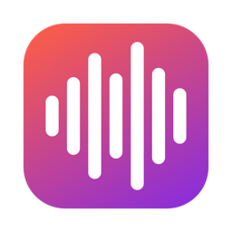
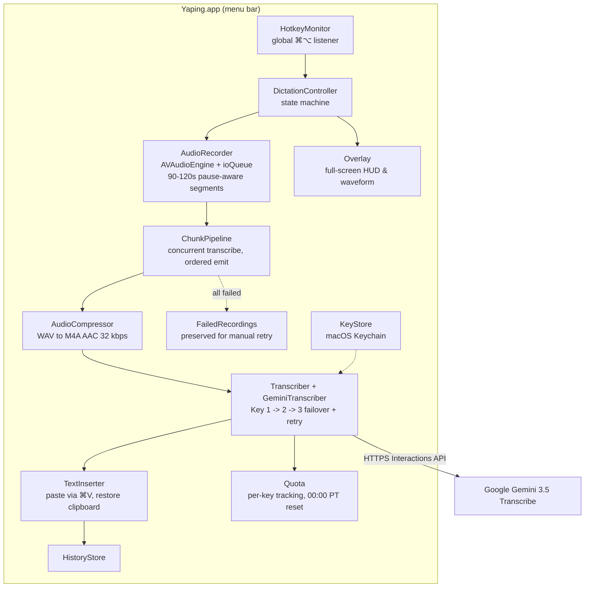

<div align="center">



# Yaping

**Free, open-source voice dictation for macOS, powered by Google Gemini 3.5 Transcribe.**

Press <kbd>⌘</kbd><kbd>⌥</kbd>, speak naturally, press again, and clean, punctuated text appears wherever your cursor is.


**[⬇️ Download for Mac](https://github.com/mnaufalzaki/Project-Portfolio/releases/tag/yaping-v1.0.1)** · [The story behind it](docs/JOURNEY.md) · [Technical docs (PDF, Indonesian)](docs/Dokumentasi%20Teknis%20Yaping.pdf)

🇬🇧 English · 🇮🇩 [Bahasa Indonesia](README.id.md)

</div>

---

## Overview

Yaping is a lightweight native menu-bar app for macOS that turns your voice into ready-to-send text in any application: Notes, Google Docs, Slack, WhatsApp, Mail, VS Code, and full-screen Safari. Built for mixed Indonesian-English speech and powered directly by **Google Gemini 3.5 Transcribe** (*smart* mode).

## Features

- **Clean output, not raw speech.** Gemini 3.5 Transcribe's *smart* mode removes filler words ("uh", "um") and resolves self-corrections ("at three, sorry, at four") while preserving your natural wording.
- **Fast, compact cloud uploads.** 16 kHz mono audio is compressed natively to **M4A (AAC 32 kbps)** before upload (~7-10x smaller than WAV), keeping typical turnaround around **1-2 seconds**.
- **Long-form dictation without long waits.** Extended recordings split on sustained pauses (400 ms silence hysteresis) every **90-120 seconds** and transcribe concurrently while you keep speaking, preserving strict output order.
- **Visible over Full-Screen apps.** The floating waveform HUD uses a non-activating screen-saver-level panel so it stays visible above full-screen Safari and other apps without stealing focus or switching Spaces.
- **Multi-key failover (1, 2, 3) & quota tracking.** Supports up to 3 Gemini API key slots in the macOS Keychain with automatic failover on HTTP 429 or errors, tracking daily resets at midnight Pacific Time.
- **Resilient by design.** Real-speech duration filtering prevents accidental hotkey toggles from burning quota. If all attempts fail (e.g., dropped network), audio chunks are preserved locally so you can retry from the menu bar.
- **Pure Swift/AppKit.** Zero external dependencies. API keys are stored securely in the macOS login Keychain.

## Installation

**Requirements:** an Apple Silicon Mac (M1 or later) running macOS 14 or later.

### Build from source (recommended)

Requires the Xcode Command Line Tools (`xcode-select --install`). The full Xcode app is not needed.

```bash
git clone https://github.com/mnaufalzaki/Project-Portfolio.git
cd Project-Portfolio/Yaping
./build.sh install
```

### First-time setup

1. **Grant permissions.** In *System Settings › Privacy & Security*, enable Yaping under **Accessibility** (named *Device Control and Data Access* on macOS 27) and **Input Monitoring**. Allow microphone access when prompted.
2. **Add your Gemini API key.** Open the menu-bar icon › *Pengaturan* (Settings) › *Mesin AI* (AI Engine) and paste an API key from [Google AI Studio](https://aistudio.google.com/apikey) into API Key 1 (optionally add Key 2 and Key 3 for failover).
3. **Dictate.** Click into any text field, press <kbd>⌘</kbd><kbd>⌥</kbd>, speak, then press <kbd>⌘</kbd><kbd>⌥</kbd> again.

> [!NOTE]
> Builds are ad-hoc signed. If you build from source, macOS treats each rebuild as a new app, so you will need to re-enable Accessibility and Input Monitoring after reinstalling.

## Usage

| Shortcut | Action |
| --- | --- |
| <kbd>⌘</kbd><kbd>⌥</kbd> | Start recording. No need to hold the keys. |
| <kbd>⌘</kbd><kbd>⌥</kbd> again | Stop, transcribe, and paste at the cursor |
| <kbd>Esc</kbd> | Cancel the current recording |
| <kbd>⌘</kbd><kbd>⌥</kbd> + another key | Treated as a regular shortcut (e.g. <kbd>⌘</kbd><kbd>⌥</kbd><kbd>D</kbd>); recording is discarded |

Hold-to-talk, <kbd>Fn</kbd>, and right-hand modifier keys are available under *Pengaturan › Umum* (Settings › General). Click the menu-bar icon anytime to check remaining daily quota, re-paste the last transcript, retry failed recordings, or browse history.

> [!TIP]
> The interface is currently in Indonesian. Quick glossary: *Pengaturan* = Settings, *Umum* = General, *Mesin AI* = AI Engine, *Riwayat* = History.

## Architecture

Yaping runs as a single native menu-bar process with a direct 1-hop pipeline to Google Gemini 3.5 Transcribe.



| Component | Responsibility |
|---|---|
| `HotkeyMonitor` | Listens for the global shortcut and starts or stops dictation. |
| `DictationController` | Orchestrates recording, silence filtering, pasting, and retrying failed chunks. |
| `AudioRecorder` | Captures 16 kHz mono audio on a dedicated serial `ioQueue` (no disk I/O on the real-time audio thread) and splits segments on sustained pauses (>= 400 ms) after 90-120 s. |
| `AudioCompressor` | Encodes WAV to native M4A (AAC 32 kbps) before cloud upload (~7-10x smaller payload). |
| `ChunkPipeline` | Transcribes segments concurrently while keeping final emission and progressive paste strictly ordered. |
| `Transcriber` & `GeminiTranscriber` | Calls the Gemini Interactions API across Key 1, Key 2, and Key 3 with automatic cooldowns on HTTP 429. |
| `Quota` | Tracks estimated per-key usage and Pacific Time midnight resets. |
| `TextInserter` | Pastes at the cursor via clipboard and reliably restores the original user clipboard. |
| `Overlay` | Non-activating HUD panel (`screenSaver` level) with symmetric center-weighted waveform animation over full-screen apps. |
| `KeyStore`, `HistoryStore`, `FailedRecordings` | macOS Keychain storage, dictation history, and local safety net for failed recordings. |

## Privacy

- API keys are stored in the macOS Keychain, never in plain text files.
- Temporary audio files are deleted right after successful transcription (up to 5 failed chunks are kept locally for retry).
- The debug log (`~/Library/Logs/Yaping.log`) records only timings and word counts, never spoken content.
- On Google AI Studio's free tier, Google may use audio to improve its products; link Cloud Billing (Pay-As-You-Go) for full data privacy.

## Building from source

Yaping is compiled directly with `swiftc` through [`build.sh`](build.sh); no Xcode project or Swift Package is required.

<details>
<summary>Project structure</summary>

```
Sources/Yaping/
├── YapingApp.swift            Entry point (+ --selftest mode)
├── AppDelegate.swift          Menu bar, Edit/Window menu (⌘V/⌘C), settings window
├── DictationController.swift  Record -> transcribe -> paste state machine + retry
├── ChunkPipeline.swift        Concurrent segment transcription with ordered output
├── AudioRecorder.swift        16 kHz mono capture, serial ioQueue, silence hysteresis
├── AudioCompressor.swift      Native WAV to M4A (AAC 32 kbps) encoder
├── HotkeyMonitor.swift        Global ⌘⌥ / Fn / modifier detection
├── Transcriber.swift          Gemini Key 1 -> 2 -> 3 failover + text normalization
├── Gemini.swift               Gemini 3.5 Transcribe client (Interactions API)
├── Quota.swift                Per-key quota tracking & Pacific Time resets
├── FailedRecordings.swift     Local safety net for failed chunks (max 5)
├── TextInserter.swift         Paste via ⌘V, smart spacing, safe clipboard restore
├── Overlay.swift              Full-screen floating waveform HUD
├── SettingsView.swift         SwiftUI settings (General, AI Engine, History)
└── …                          Settings, KeyStore, History, Log, Permissions, SelfTest
```

</details>

## Credits

Built by **Naufal Zaki** ([naufalzaki.tech](https://naufalzaki.tech) · [@mnaufalzaki](https://github.com/mnaufalzaki)). Inspired by [Wispr Flow](https://wisprflow.ai/) and powered by the [Google Gemini API](https://ai.google.dev/).

## License

Released under the [MIT License](LICENSE). © 2026 Naufal Zaki.
