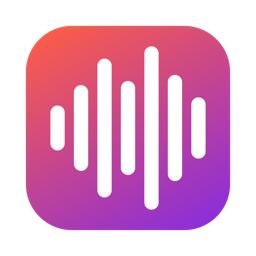
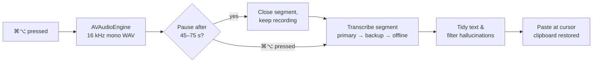

<div align="center">



# Yaping

**Free, open-source voice dictation for macOS, in the spirit of Wispr Flow.**

Press <kbd>⌘</kbd><kbd>⌥</kbd>, speak naturally, press again, and clean, punctuated text appears wherever your cursor is.


**[⬇️ Download for Mac](https://github.com/mnaufalzaki/Project-Portfolio/releases/tag/yaping-v1.0)** · [The story behind it](docs/JOURNEY.md) · [Technical docs (PDF, Indonesian)](docs/Dokumentasi%20Teknis%20Yaping.pdf)

🇬🇧 English · 🇮🇩 [Bahasa Indonesia](README.id.md)

</div>

---

## Overview

Yaping is a lightweight menu-bar app that turns your voice into ready-to-send text in any application: Notes, Google Docs, Slack, WhatsApp, Mail, VS Code and more. It was designed for mixed Indonesian–English speech, and it works with any language supported by the transcription engine you choose.

You choose where your audio is processed: Google Gemini for the cleanest output, Groq for raw speed, or a fully offline whisper.cpp model that never leaves your Mac. Every option has a free tier.

## Features

- **Clean output, not raw speech.** In Gemini's *smart* mode, filler words ("uh", "um") and self-corrections ("at three, sorry, at four") are resolved automatically, and your own wording is preserved.
- **Unlimited-length dictation.** Long recordings are split at natural pauses into ~1-minute segments that are transcribed *while you are still speaking*. In testing, the wait after a 5-minute dictation dropped from **143 s to 2.3 s**.
- **Progressive output.** For long sessions, text can appear segment by segment as you talk. This is useful for live notes in meetings or lectures.
- **Multiple engines, one shortcut.** Switch between Gemini, Groq, local whisper.cpp, Apple Speech or any OpenAI-compatible endpoint from the settings window.
- **Automatic fallback and quota tracking.** Choose a primary and a backup engine. When the primary hits its free-tier limit or the network fails, Yaping switches over on the fly and can fall back to offline Whisper as a last resort. Remaining daily quota and reset times are shown in the menu bar.
- **Custom vocabulary.** Teach Yaping the names, acronyms and jargon you use so they are spelled correctly.
- **Built to be reliable.** Each segment is retried automatically, the Mac is kept awake while recording, your clipboard is restored after pasting, and known Whisper "silence hallucinations" are filtered out.
- **Native and lightweight.** A pure Swift/AppKit app using roughly 190 MB of RAM and under 1% CPU when idle. API keys are stored in the macOS Keychain.

## Installation

**Requirements:** an Apple Silicon Mac (M1 or later) running macOS 14 or later.

### Option A: Download (recommended)

1. Download **`Yaping-1.0.zip`** from the [release page](https://github.com/mnaufalzaki/Project-Portfolio/releases/tag/yaping-v1.0), unzip it, and drag **Yaping.app** into **Applications**.
2. Open Yaping. macOS will warn that it *"could not verify"* the app, because free open-source apps aren't notarized by Apple. Go to **System Settings › Privacy & Security**, scroll down and click **Open Anyway**. You only need to do this once.

### Option B: Build from source

Requires the Xcode Command Line Tools (`xcode-select --install`). The full Xcode app is not needed.

```bash
git clone https://github.com/mnaufalzaki/Project-Portfolio.git
cd Project-Portfolio/Yaping
./build.sh install
```

### First-time setup

1. **Grant permissions.** In *System Settings › Privacy & Security*, enable Yaping under **Accessibility** (named *Device Control and Data Access* on macOS 27) and **Input Monitoring**. Allow microphone access when prompted.
2. **Choose an engine.** Open the menu-bar icon › *Pengaturan* (Settings) › *Mesin AI* (AI Engines), select a provider and paste its free API key. For the offline engine, run `./scripts/setup-local.sh` from the source folder instead.
3. **Dictate.** Click into any text field, press <kbd>⌘</kbd><kbd>⌥</kbd>, speak, then press <kbd>⌘</kbd><kbd>⌥</kbd> again.

> [!NOTE]
> Builds are ad-hoc signed. If you build from source, macOS treats every rebuild as a new app, so you'll need to re-enable the permissions after each reinstall.

## Usage

| Shortcut | Action |
| --- | --- |
| <kbd>⌘</kbd><kbd>⌥</kbd> | Start recording. No need to hold the keys. |
| <kbd>⌘</kbd><kbd>⌥</kbd> again | Stop, transcribe and paste at the cursor |
| <kbd>Esc</kbd> | Cancel the current recording |
| <kbd>⌘</kbd><kbd>⌥</kbd> + another key | Treated as a regular shortcut (e.g. <kbd>⌘</kbd><kbd>⌥</kbd><kbd>D</kbd>); recording is discarded |

Hold-to-talk, <kbd>Fn</kbd> and right-hand modifier keys are available under *Pengaturan › Umum* (Settings › General). Click the menu-bar icon at any time to see your remaining daily quota, re-paste the last result or browse recent dictations.

> [!TIP]
> The interface is currently in Indonesian. Quick glossary: *Pengaturan* = Settings, *Umum* = General, *Mesin AI* = AI Engines, *Kosakata* = Vocabulary, *Riwayat* = History.

## Transcription engines

| Engine | Best for | Speed* | Privacy | Get a key |
| --- | --- | --- | --- | --- |
| **Gemini 3.5 Transcribe** | Cleanest, best-punctuated text; smart mode; vocabulary of up to 1,000 terms | ~3 s | Cloud. On the free tier, Google may use audio to improve its products. | [Google AI Studio](https://aistudio.google.com/apikey) |
| **Groq** (Whisper large-v3) | Fastest turnaround | ~1 s | Cloud | [Groq Console](https://console.groq.com/keys) |
| **whisper.cpp** (local) | Fully offline, private, unlimited | ~1.5–3 s | Audio never leaves your Mac | Not needed |
| **Apple Speech** | Zero setup | Fast | On-device | Not needed |
| **Custom** | Any OpenAI-compatible `/audio/transcriptions` endpoint | Varies | Depends on the provider | Varies |

<sub>*Typical wait after you stop speaking, measured on an M3 MacBook. Longer dictations stay in the same range thanks to segmenting.</sub>

An optional AI rewriting pass (Groq, Claude or Ollama) is included but off by default. Gemini's smart mode already tidies text while keeping your voice.

### Fallback and quotas

Free tiers have limits. The Gemini 3.5 Transcribe free tier allowed only **25 requests per day** in our testing, so Yaping lets you set a **primary** and a **backup** engine under *Pengaturan › Mesin AI*, plus an optional offline last resort:

```
Gemini (primary) ──fails──▶ Groq (backup) ──fails──▶ local whisper.cpp (offline)
```

- **Seamless switching.** If an engine hits its rate limit, returns an error, has no API key or the network is down, the next engine takes over for that segment. A short notice tells you which engine was used and why.
- **Smart cooldown.** When a provider reports a limit, Yaping reads the exact retry time from its response (e.g. *"retry in 10h59m"*) and skips that engine until then, so no time is wasted on requests that are bound to fail. This state survives app restarts.
- **Quota at a glance.** The menu bar and Settings show what's left today, along with an in-app warning when you're running low:

  ```
  Kuota hari ini
     Gemini: ±18 / 25 tersisa · reset 07.00
     Groq: 1,990 / 2,000 tersisa · reset 20.45
  ```

  Groq's figures are exact (read from its rate-limit headers). Gemini doesn't expose remaining quota, so Yaping counts its own requests (marked **±**). The count resets at midnight UTC and is corrected automatically by Google's response once the limit is reached.

## How it works



Segments are processed strictly in order, each falling back through your engine chain and retried once if every engine fails, so the final text is complete and correctly sequenced. Only the last segment is pending when you stop, which is why the wait stays short however long you speak.

## Benchmarks

Measured on an Apple M3 MacBook while building Yaping. The full story, with every test, is in [The story behind Yaping](docs/JOURNEY.md).

| Test | Result |
| --- | --- |
| 5-minute dictation, before vs after live segmenting | Wait after stopping: **143 s → 2.3 s** (7 segments, 0 failures) |
| Gemini vs Groq, same speaker | Gemini: clean punctuation, brand names correct · Groq: faster, but one run-on sentence |
| Gemini processing vs audio length | 24 s → 3 s · 59 s → 8 s · 85 s → 15 s · 5 min → 143 s (why segments are ~1 min) |
| Double failure in real use | Gemini quota exhausted **and** Wi-Fi dropped mid-request → offline Whisper delivered all 129 words |
| Idle footprint | ~190 MB RAM, ~0.5% CPU |

## Privacy

- API keys are stored in the macOS Keychain, never in plain files.
- Audio is held in temporary files that are deleted right after transcription.
- The debug log (`~/Library/Logs/Yaping.log`) records only timings and word counts, never what you said.
- Quota counters are stored locally and contain request counts only.
- For complete privacy, use the local whisper.cpp engine. With it, Yaping makes no network requests for transcription.

## Troubleshooting

| Problem | Fix |
| --- | --- |
| Nothing happens when pressing <kbd>⌘</kbd><kbd>⌥</kbd> | Re-enable Yaping under Accessibility and Input Monitoring (required after every reinstall). |
| "Teks disalin — tekan ⌘V" | Accessibility permission is missing, so the text was copied to the clipboard instead of pasted. |
| Names or acronyms are misspelled | Add them in *Pengaturan › Kosakata* (Settings › Vocabulary). |
| "Pakai cadangan — Gemini: kuota habis …" | Expected behaviour: Gemini's daily free quota is used up, so the backup engine is transcribing. Gemini is used again automatically after the reset time shown in the menu bar. |
| Gemini quota shows "±" remaining but requests are refused | The estimate only counts Yaping's own requests. If the same key is used elsewhere, the first refusal corrects the figure. |
| Want to test without the microphone | `/Applications/Yaping.app/Contents/MacOS/Yaping --selftest recording.wav` |

## Building from source

Yaping is compiled directly with `swiftc` through [`build.sh`](build.sh); no Xcode project or Swift Package is required. The build script signs with an Apple Development certificate if one is available and falls back to ad-hoc signing otherwise. `./scripts/package.sh` produces the release zip in `dist/`.

<details>
<summary>Project structure</summary>

```
Sources/Yaping/
├── YapingApp.swift            Entry point (+ --selftest mode)
├── AppDelegate.swift          Menu bar, settings window, permissions flow
├── DictationController.swift  Record → transcribe → paste state machine
├── ChunkPipeline.swift        Ordered, retrying segment transcription
├── AudioRecorder.swift        16 kHz mono capture with pause-aware segmenting
├── HotkeyMonitor.swift        Global ⌘⌥ / Fn / modifier detection
├── Transcriber.swift          Engine chain with fallback, transcript tidying, Whisper APIs
├── Quota.swift                Free-tier usage tracking, reset times and cooldowns
├── Gemini.swift               Gemini 3.5 Transcribe (Interactions API)
├── Groq.swift                 Chat-model discovery for the optional rewriting step
├── LocalEngines.swift         Managed whisper.cpp server and Ollama client
├── TextCleaner.swift          Optional AI rewriting
├── TextInserter.swift         Paste via ⌘V, smart spacing, clipboard restore
├── Overlay.swift              Floating waveform indicator
├── SettingsView.swift         SwiftUI settings
└── …                          Settings, KeyStore, History, Log, Permissions
```

</details>

## Credits

Built in a single day by **Naufal Zaki** ([naufalzaki.tech](https://naufalzaki.tech) · [@mnaufalzaki](https://github.com/mnaufalzaki)), who designed and tested every step, mostly by voice through Yaping itself, with [Claude Code](https://claude.com/claude-code) as pair-programmer. Read [the story behind Yaping](docs/JOURNEY.md).

## Acknowledgements

- [whisper.cpp](https://github.com/ggml-org/whisper.cpp) and OpenAI's [Whisper](https://github.com/openai/whisper) models
- [Google Gemini API](https://ai.google.dev/) and [Groq](https://groq.com/)
- Inspired by [Wispr Flow](https://wisprflow.ai/)

## License

Released under the [MIT License](LICENSE). © 2026 Naufal Zaki.
