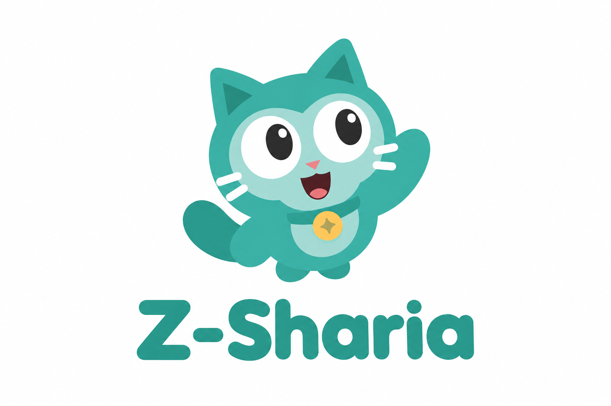
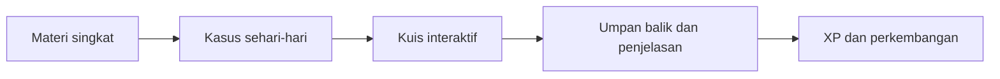
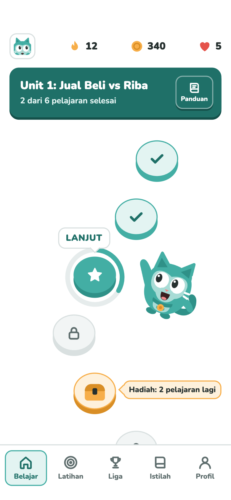
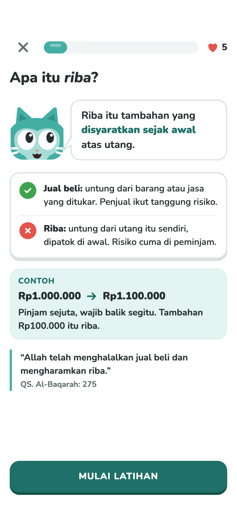
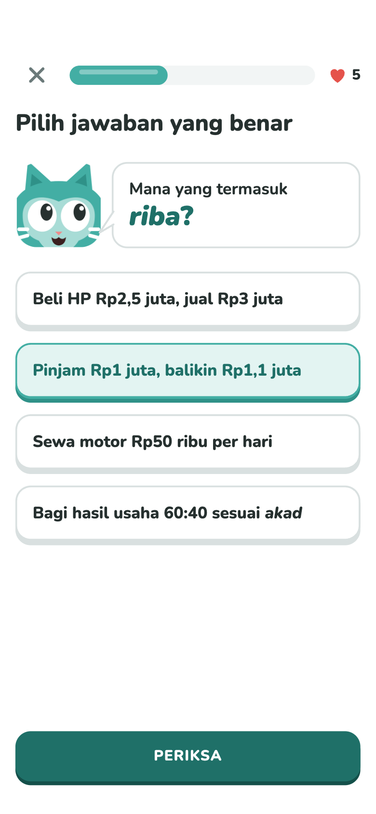
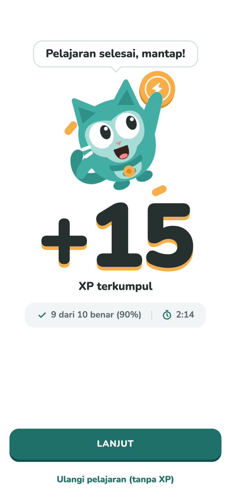
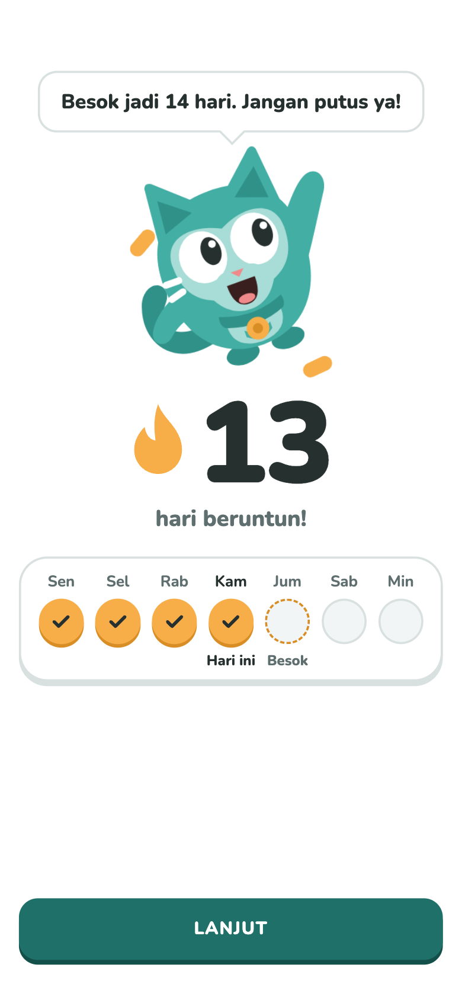
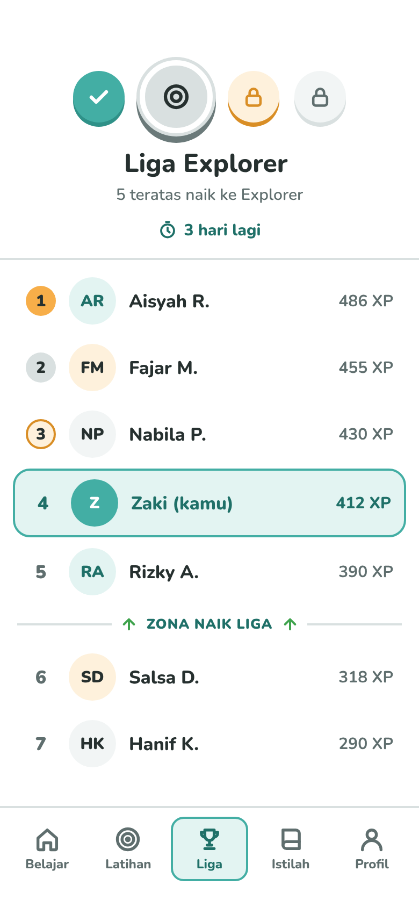
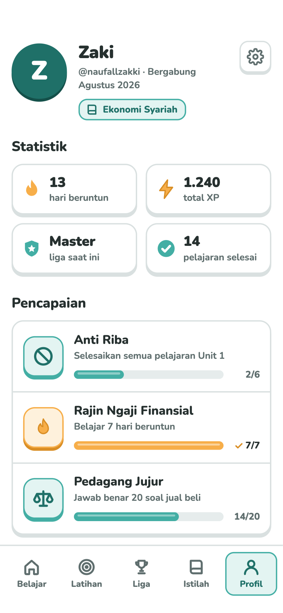
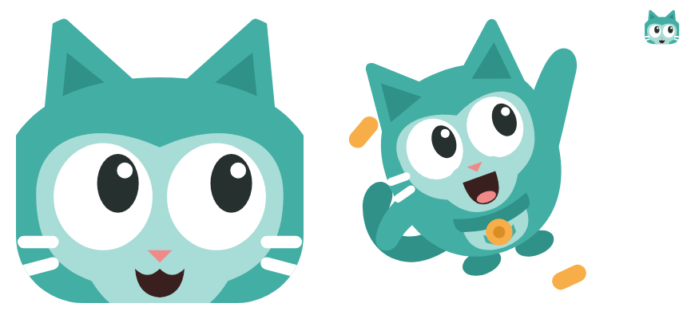

<div align="center">



# Z-Sharia

**Pembelajaran ekonomi dan keuangan syariah berbasis gamifikasi untuk mahasiswa Muslim.**

*Pahami konsepnya. Terapkan. Terus belajar.*


**[📄 Presentasi (PDF)](docs/Z-Sharia-Presentation.pdf) · [📝 Proposal (Word)](docs/Z-Sharia-Proposal.docx)**

🇬🇧 [English](README.md) · 🇮🇩 Bahasa Indonesia

</div>

---

## Gambaran Umum

Z-Sharia adalah konsep aplikasi pembelajaran yang membantu mahasiswa Muslim memahami ekonomi dan keuangan syariah melalui **materi singkat, kasus sehari-hari, dan gamifikasi**.

Setiap pelajaran memperkenalkan konsep sebelum pengguna diminta menerapkannya. Studi kasus dan kuis menghubungkan istilah seperti riba, gharar, dan akad dengan keputusan keuangan yang dekat dengan kehidupan mahasiswa. Umpan balik menjelaskan alasan di balik jawaban, sedangkan XP, streak harian, lencana, dan liga dirancang untuk memperlihatkan perkembangan serta mendorong kebiasaan belajar.

> **Status proyek:** Tahap konsep dan desain antarmuka. Folder ini memuat presentasi, proposal, identitas visual, dan tujuh rancangan layar. Kode aplikasi dan hasil evaluasi belum disertakan. Fitur serta kegiatan validasi di bawah merupakan rancangan produk dan rencana pengembangan.

## Masalah

Proyek ini berangkat dari tiga tantangan pembelajaran yang diuraikan dalam proposal dan presentasi:

- **Konsep terasa abstrak.** Definisi saja dapat sulit dihubungkan dengan kegiatan meminjam, membelanjakan uang, menabung, atau memilih produk keuangan.
- **Pembelajaran membutuhkan konteks.** Mahasiswa perlu berlatih menelaah transaksi, mengambil keputusan, dan memahami prinsip yang mendasarinya.
- **Konsistensi membutuhkan dukungan.** Materi edukasi perlu dilengkapi jalur belajar yang jelas dan perkembangan yang terlihat agar pengguna terdorong untuk kembali belajar.

Sasaran awalnya adalah mahasiswa Muslim di Indonesia, dengan rencana uji coba pertama bersama penerima BSI Scholarship.

## Solusi

Rancangan pembelajaran mengikuti tiga prinsip:

| Prinsip | Pengalaman yang dirancang |
|---|---|
| **Pahami** | Membaca penjelasan singkat, ilustrasi, dan contoh sehari-hari sebelum mencoba topik baru. |
| **Praktikkan** | Mengerjakan kasus atau kuis, lalu menerima umpan balik yang menjelaskan jawabannya. |
| **Pertahankan** | Melihat perkembangan melalui XP, streak, pencapaian, dan liga. |

Gamifikasi terinspirasi dari aplikasi seperti Duolingo, dengan pengantar yang menjelaskan setiap konsep keuangan baru sebelum latihan dimulai.

## Alur Pembelajaran



Perjalanan pengguna yang direncanakan dimulai dari pendaftaran dan tes awal, dilanjutkan dengan modul pembelajaran serta pemantauan perkembangan, lalu diakhiri dengan tes akhir dan masukan pengguna.

## Struktur Materi

Proposal membagi materi menjadi empat modul, mulai dari konsep dasar hingga penerapan dalam pengambilan keputusan:

| Modul | Pokok bahasan |
|---|---|
| **Dasar Ekonomi Syariah** | Landasan ekonomi Islam, keadilan, serta transaksi yang diperbolehkan dan dilarang. |
| **Keuangan Pribadi Syariah** | Konsumsi yang bertanggung jawab, zakat, sedekah, dan perencanaan keuangan. |
| **Produk Keuangan Syariah** | Perbankan syariah, akad, asuransi syariah, reksa dana syariah, dan pasar modal. |
| **Penerapan Ekonomi Syariah** | Bisnis halal, investasi syariah, industri halal, dan pengambilan keputusan ekonomi. |

Struktur ini masih berupa kerangka materi. Peninjauan isi oleh ahli menjadi bagian dari persiapan uji coba.

## Galeri Antarmuka

Ketujuh rancangan layar berikut memperlihatkan pengalaman yang diusulkan. Klik gambar untuk melihat ukuran penuhnya; angka, nama, dan skor di dalamnya merupakan ilustrasi.

### Belajar dan berlatih

| Beranda dan jalur belajar | Pengantar materi | Soal latihan |
|:---:|:---:|:---:|
| <a href="docs/images/01-home.png"></a> | <a href="docs/images/02-material-introduction.png"></a> | <a href="docs/images/03-practice.png"></a> |

### Merayakan pencapaian dan menjaga kebiasaan

| Pelajaran selesai | Streak harian | Peringkat liga |
|:---:|:---:|:---:|
| <a href="docs/images/04-lesson-complete.png"></a> | <a href="docs/images/05-streak.png"></a> | <a href="docs/images/06-league.png"></a> |

### Perkembangan pribadi

<div align="center">

<a href="docs/images/07-profile.png"></a>

<p><strong>Profil dan pencapaian</strong><br>Statistik belajar, akumulasi XP, liga saat ini, dan perkembangan pencapaian.</p>

</div>

## Gamifikasi dan Identitas Visual

| Elemen | Fungsi yang dirancang |
|---|---|
| XP | Menunjukkan perkembangan dari aktivitas belajar dan pelajaran yang diselesaikan. |
| Streak harian | Mendorong rutinitas belajar pribadi yang konsisten. |
| Peringkat dan liga | Memberikan jenjang kompetisi berdasarkan XP. |
| Lencana dan pencapaian | Mengapresiasi tonggak belajar dan penyelesaian topik. |
| Maskot kucing | Memandu pengguna, menjelaskan konsep, dan merayakan pencapaian. |

<div align="center">



</div>

Identitas visual yang tersedia menggunakan warna toska, aksen hangat pada penghargaan, dan karakter kucing yang ramah. **Campus Squad dan Liga Kampus** merupakan usulan fitur komunitas untuk tahap berikutnya dalam presentasi.

## Rencana Validasi Awal

Presentasi mengusulkan uji coba bersama **30 penerima BSI Scholarship**, selama **empat minggu**, dengan target belajar **sekitar lima menit per hari**.

Persiapannya mencakup aplikasi yang dapat digunakan, peninjauan materi oleh ahli, soal tes awal dan tes akhir yang setara, serta orientasi peserta. Alur yang direncanakan meliputi tes awal, pembelajaran dengan pendampingan, pemantauan aktivitas, lalu tes akhir dan pengumpulan masukan pengguna.

| Aspek | Cara pengukuran yang direncanakan |
|---|---|
| Pemahaman | Membandingkan skor tes awal dan tes akhir pada skala 0–100. |
| Keyakinan diri | Membandingkan penilaian keyakinan diri melalui skala Likert 1–5. |
| Penyelesaian | Mencatat persentase peserta yang menyelesaikan modul. |
| Keterlibatan | Mencatat jumlah hari aktif belajar per minggu. |

**Batasan evaluasi:** Uji coba yang diusulkan tidak menggunakan kelompok kontrol. Hasilnya dapat menggambarkan perubahan selama uji coba, tetapi belum dapat membuktikan bahwa perubahan tersebut semata-mata disebabkan oleh Z-Sharia. Repositori ini belum memuat hasil uji coba.

## Rencana Pengembangan

| Tahap | Fokus |
|---|---|
| Persiapan | Menyelesaikan aplikasi yang dapat digunakan, materi, peninjauan ahli, dan instrumen evaluasi. |
| Uji coba awal | Merekrut dan memberikan orientasi kepada peserta, lalu menjalankan pembelajaran selama empat minggu. |
| Evaluasi dan penyempurnaan | Menelaah skor tes, data aktivitas, dan masukan peserta untuk memperbaiki pengalaman belajar. |
| Perluasan kampus | Mempertimbangkan penggunaan yang lebih luas melalui komunitas perguruan tinggi setelah kesiapan dan hasil uji coba dievaluasi. |

Presentasi menempatkan implementasi awal dalam **rencana 10 minggu**, mencakup persiapan, masa pembelajaran, dan evaluasi. Perluasan merupakan arah pengembangan berikutnya.

## Materi Proyek

| Materi | Isi |
|---|---|
| [Presentasi (PDF)](docs/Z-Sharia-Presentation.pdf) | 25 halaman yang membahas masalah, desain pembelajaran, konsep antarmuka, rencana implementasi, dan pendekatan evaluasi. |
| [Proposal (Word)](docs/Z-Sharia-Proposal.docx) | Latar belakang, tujuan, struktur materi, rancangan gamifikasi, dan usulan tahapan pengembangan. |
| [Gambar antarmuka dan identitas visual](docs/images/) | Tujuh rancangan layar, gambar sampul, dan ilustrasi maskot. |

Presentasi menjadi acuan utama README ini, sedangkan proposal melengkapi rinciannya. Dokumen asli dipertahankan; README merangkum proyek agar mudah dipahami pembaca portofolio.

## Struktur Repositori

```text
Z-Sharia/
├── README.md                       # Dokumentasi bahasa Inggris
├── README.id.md                    # Dokumentasi bahasa Indonesia
└── docs/
    ├── Z-Sharia-Presentation.pdf    # Presentasi asli
    ├── Z-Sharia-Proposal.docx       # Proposal asli
    └── images/                     # Sampul, maskot, dan tujuh layar bernomor
```

## Tim

Sesuai nama yang tercantum pada sampul presentasi:

- **Muhammad Naufal Zaki**
- **Mohamad Rizal Nurochman**
- **Fariel Nurdiyansyah**

---

<sub>Z-Sharia · Konsep proyek, desain pembelajaran, dan materi antarmuka · SYLS 2026</sub>
