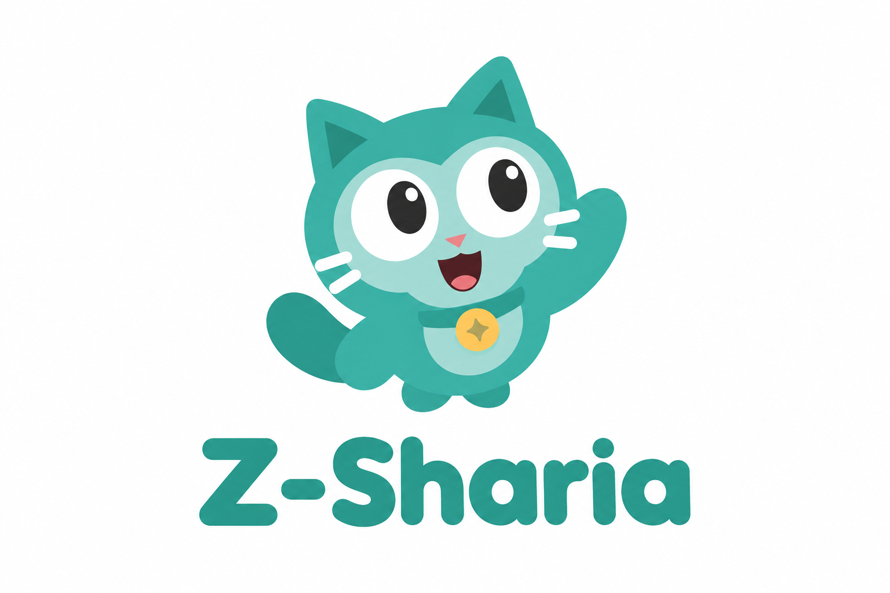
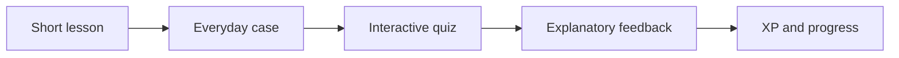
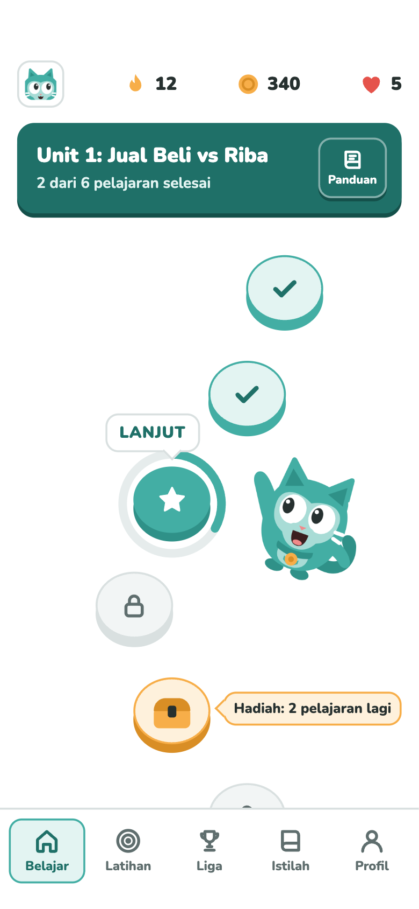
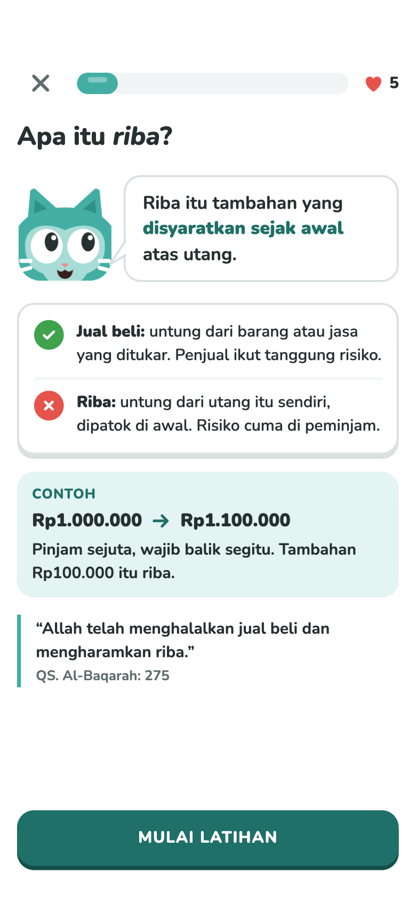
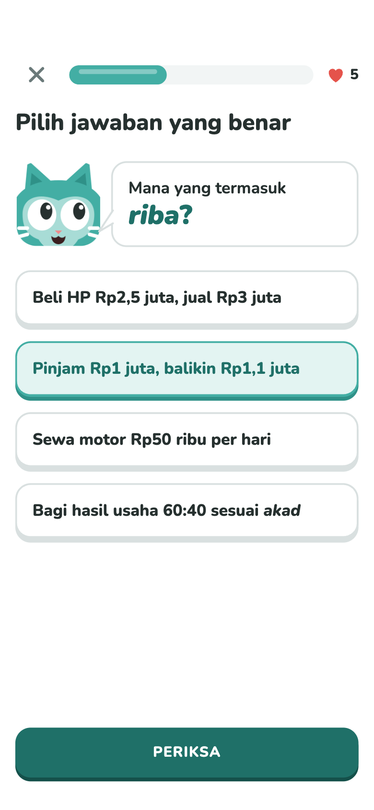
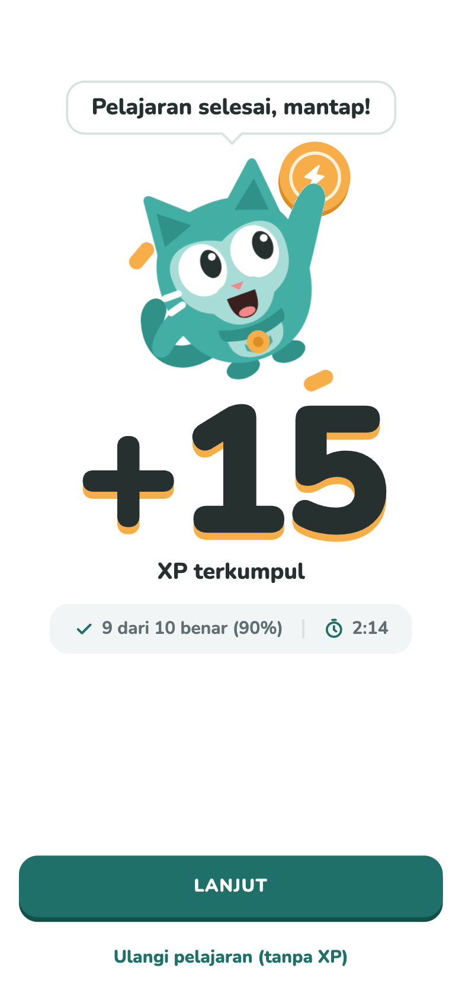
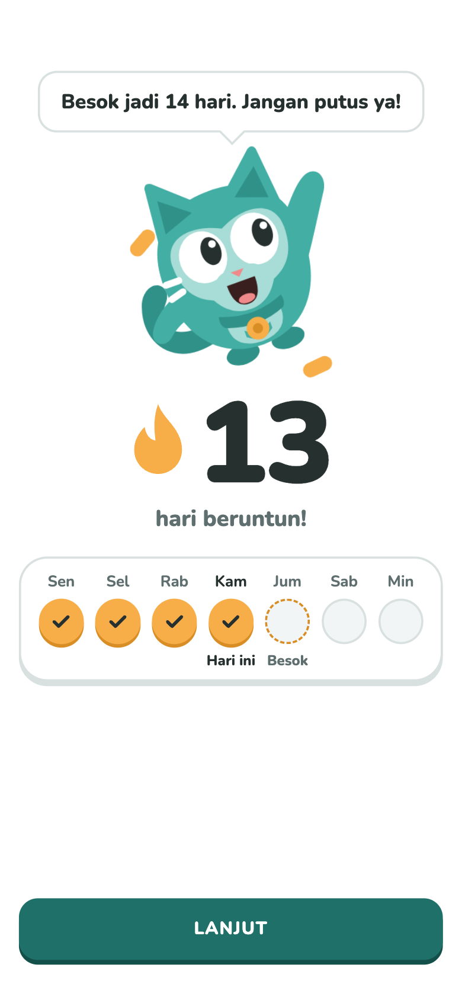
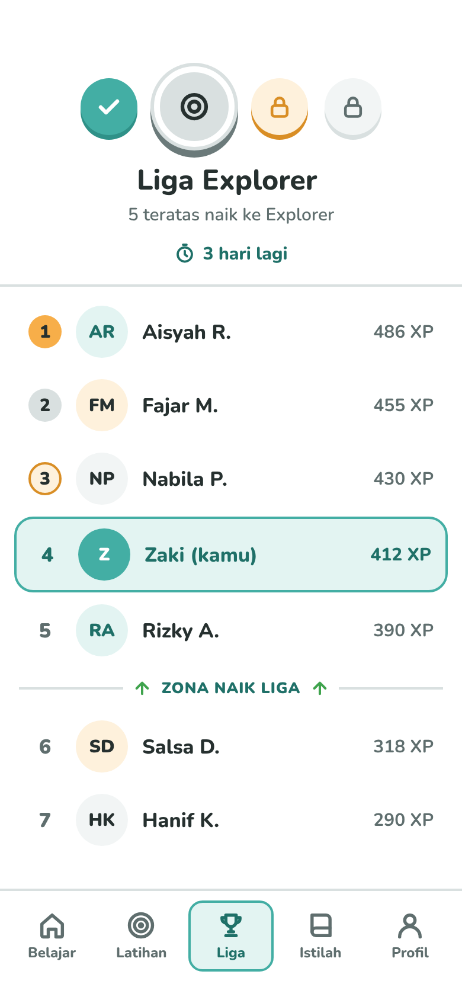
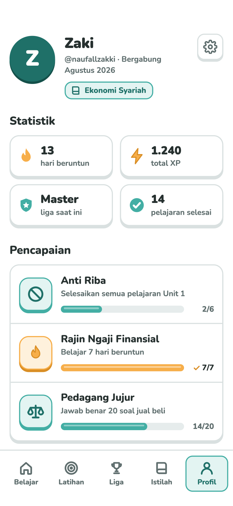
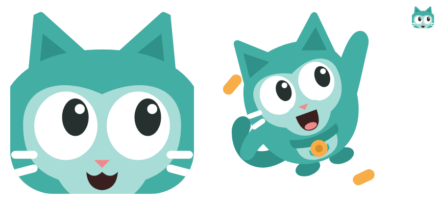

<div align="center">



# Z-Sharia

**Gamified Islamic economics and finance learning for Muslim university students.**

*Understand the concept. Apply it. Keep learning.*


**[📄 Presentation (PDF)](docs/Z-Sharia-Presentation.pdf) · [📝 Proposal (Word)](docs/Z-Sharia-Proposal.docx)**

🇬🇧 English · 🇮🇩 [Bahasa Indonesia](README.id.md)

</div>

---

## Overview

Z-Sharia is a learning app concept that helps Muslim university students understand Islamic economics and finance through **short lessons, everyday scenarios, and gamification**.

Each lesson introduces a concept before asking students to apply it. Case studies and quizzes connect ideas such as riba, gharar, and transaction contracts to familiar financial decisions, while feedback explains the reasoning behind an answer. XP, daily streaks, badges, and leagues are designed to make progress visible and encourage regular learning.

> **Project status:** Concept and UI-design stage. This folder contains the presentation, proposal, visual identity, and seven interface mockups. Application source code and evaluation results are not included. Features and validation activities described below represent the intended product design and development plan.

## The Problem

The project addresses three learning challenges identified in its proposal and presentation:

- **Concepts can feel abstract.** Definitions alone may be difficult to connect to borrowing, spending, saving, or choosing financial products.
- **Learning needs context.** Students need opportunities to consider a transaction, make a decision, and understand the principles behind it.
- **Consistency needs support.** Educational content needs a clear learning path and visible progress to encourage students to return.

The intended starting audience is Muslim university students in Indonesia, with an initial pilot planned for BSI Scholarship recipients.

## The Solution

The learning design follows three principles:

| Principle | Intended experience |
|---|---|
| **Understand** | Read a short explanation, illustration, and everyday example before attempting a new topic. |
| **Apply** | Work through a case or quiz and receive feedback explaining the answer. |
| **Keep learning** | See progress through XP, streaks, achievements, and leagues. |

Gamification takes inspiration from apps such as Duolingo, with an explicit introduction to each new finance concept before practice.

## Learning Flow



The planned student journey begins with registration and an initial assessment, continues through learning modules and progress tracking, and ends with a follow-up assessment and user feedback.

## Curriculum

The proposal outlines four modules, moving from foundational concepts to practical decisions:

| Module | Topics |
|---|---|
| **Basic Islamic Economics** | Foundations of Islamic economics, fairness, and permitted and prohibited transactions. |
| **Islamic Personal Finance** | Responsible spending, zakat, charitable giving, and financial planning. |
| **Islamic Financial Products** | Islamic banking, transaction contracts, takaful, Islamic mutual funds, and capital markets. |
| **Islamic Economic Application** | Halal business, Islamic investing, the halal industry, and economic decision-making. |

The curriculum remains a design framework. Expert review of the content is part of the preparation for a pilot.

## Interface Gallery

These seven mockups show the proposed experience. Click an image to inspect it at full size; the numbers, names, and scores shown are illustrative.

### Learn and practice

| Learning path | Material introduction | Practice question |
|:---:|:---:|:---:|
| <a href="docs/images/01-home.png"></a> | <a href="docs/images/02-material-introduction.png"></a> | <a href="docs/images/03-practice.png"></a> |

### Celebrate progress and return

| Lesson complete | Daily streak | League standings |
|:---:|:---:|:---:|
| <a href="docs/images/04-lesson-complete.png"></a> | <a href="docs/images/05-streak.png"></a> | <a href="docs/images/06-league.png"></a> |

### Personal progress

<div align="center">

<a href="docs/images/07-profile.png"></a>

<p><strong>Profile and achievements</strong><br>Learning statistics, accumulated XP, current league, and achievement progress.</p>

</div>

## Gamification and Visual Identity

| Element | Intended role |
|---|---|
| XP | Show progress from learning activities and completed lessons. |
| Daily streak | Encourage a consistent personal learning routine. |
| Ranks and leagues | Add a competitive progression system based on XP. |
| Badges and achievements | Recognize milestones and topic completion. |
| Cat mascot | Guide learners, explain concepts, and celebrate progress. |

<div align="center">



</div>

The existing visual identity uses teal, warm reward accents, and a friendly cat character. **Campus Squad and Campus League** are proposed later-stage community features in the presentation.

## Pilot Validation Plan

The presentation proposes **30 BSI Scholarship recipients**, learning for **four weeks** with a target of **about five minutes a day**.

Preparation includes a functional application, expert content review, comparable pre-test and post-test questions, and participant orientation. The planned sequence is an initial assessment, guided learning, activity monitoring, and a final assessment with user feedback.

| Measure | Planned method |
|---|---|
| Understanding | Compare pre-test and post-test scores on a 0–100 scale. |
| Confidence | Compare self-reported confidence using a 1–5 Likert scale. |
| Completion | Track the proportion of participants who finish the modules. |
| Engagement | Record active learning days per week. |

**Evaluation limit:** The proposed pilot has no control group. It can describe changes during the pilot, but cannot establish that Z-Sharia alone caused them. No pilot results are reported in this repository.

## Development Roadmap

| Stage | Focus |
|---|---|
| Preparation | Finalize a functional application, learning materials, expert review, and assessment instruments. |
| Initial pilot | Recruit and orient participants, then run the planned four-week learning period. |
| Evaluation and iteration | Review assessment scores, activity data, and participant feedback to refine the experience. |
| Campus expansion | Consider wider use through university communities after evaluating readiness and pilot findings. |

The presentation frames the initial implementation as a **10-week plan**, including preparation, the learning period, and evaluation. Expansion is a future direction rather than a completed deployment.

## Project Materials

| Material | Contents |
|---|---|
| [Presentation (PDF)](docs/Z-Sharia-Presentation.pdf) | 25 pages covering the problem, learning design, interface concept, implementation plan, and evaluation approach. |
| [Proposal (Word)](docs/Z-Sharia-Proposal.docx) | Supporting background, objectives, curriculum, gamification design, and proposed development stages. |
| [Interface and identity images](docs/images/) | Seven screen mockups, the cover artwork, and mascot artwork. |

The presentation is the primary reference for this README, with the proposal providing supporting detail. The original documents are preserved; this README summarizes the project for portfolio readers.

## Repository Structure

```text
Z-Sharia/
├── README.md                       # English documentation
├── README.id.md                    # Indonesian documentation
└── docs/
    ├── Z-Sharia-Presentation.pdf    # Original presentation
    ├── Z-Sharia-Proposal.docx       # Original proposal
    └── images/                     # Cover, mascot, and seven numbered screens
```

## Team

As credited on the presentation cover:

- **Muhammad Naufal Zaki**
- **Mohamad Rizal Nurochman**
- **Fariel Nurdiyansyah**

---

<sub>Z-Sharia · Project concept, learning design, and interface materials · SYLS 2026</sub>
